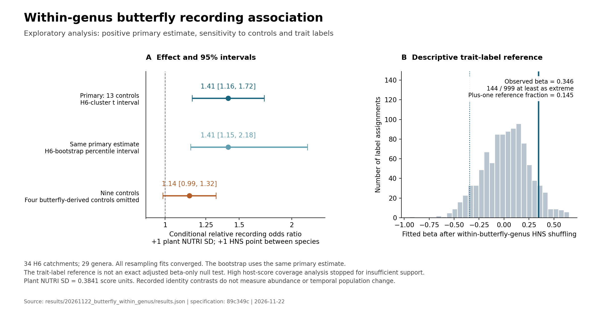

# 蝶の同属種間における植物NUTRIとの対応：探索解析

2026年11月22日。解析対象は既存の183 H7・40 H6、2017–2019年と2020–2022年。新しい場所や独立した検証データは追加していない。

## 結論

**同じ蝶属の種どうしを直接比べると、植物NUTRIが高い小流域で、寄主栄養スコア（HNS）が高い種が相対的に記録されやすいという正の関連が主解析で得られた。ただし、調整変数への依存が大きく、HNSラベルを属内で入れ替えた比較でも明確には突出しない。現時点の結論は「属内の対応を示唆する探索的結果」である。**

この会話で検討していた「蝶は属ごとにしか応答できない」「系統的な制約がその原因」という仮説を、このデータで確立したとはいえない。以前の *p* = 0.6864 は、**植物のNUTRIを植物の属内で入れ替え、蝶のHNSは固定した解析**の値だった。蝶の属内種交代を直接検定した値ではない。この誤読は今回の結果が正か負かにかかわらず訂正する必要がある。[1]

今回の主解析のオッズ比は **1.413、95%区間1.160–1.720、名目上の両側 *p* = 0.00112**。一方、蝶の記録から算出した4つの調整変数を外すと **1.143、95%区間0.988–1.321、*p* = 0.0705** まで弱まる。主解析のみを取り出して、頑健な食性機構を確認したと扱うことはできない。[2]



## 1. 今回比べたもの

HNSは、既存の寄主データで数値スコアを取得できた寄主植物について、そのNUTRIを平均した値である。実測の窒素濃度、幼虫の摂食量、個体群増加率ではない。寄主スコア取得率は `n_scored_hosts / n_documented_host_concepts` であり、その種について知られている寄主のすべてが網羅されていることを保証する指標でもない。[3]

同じ蝶属から2種A・Bを選び、同じ親流域H6・同じ期間の中で、次のような小流域H7を比較した。

- Aだけが記録された小流域。
- Bだけが記録された小流域。

A・Bの両方が記録された小流域と、どちらも記録されなかった小流域は、このペア比較には使っていない。「記録されなかった」を生物学的な不在とは扱っていない。蝶の記録件数は応答に使わず、同じ種の記録が1件でも100件でも「記録あり」の1つとして扱った。[4]

比較する環境は、その期間にその小流域で記録された、数値NUTRIのある植物種の種等重み平均である。原データ366小流域・期間の平均4.65538、標準偏差0.384068を固定して標準化した。[2,4]

ここでいう「同属内の対応」は、**同じ親流域・期間内の小流域間における、相対的な記録のされ方と植物NUTRIの空間的な関連**である。2期間のデータは使っているが、同じ場所でどの種が増減したかという時間変化を推定してはいない。

### オッズ比の読み方

HNSが1点高い種Aと低い種Bのペアについて、植物NUTRIが1標準偏差、すなわち約0.384点高い小流域では、他の調整変数を同じとしたとき、Aだけが記録される相対オッズがBだけの場合に対して約1.41倍になるという推定である。

これは蝶の数が41%多いという意味ではなく、Aの記録確率が41ポイント上がるという意味でもない。HNS差に比例する共通係数を仮定しており、各種・各属に固有の環境応答を推定した結果ではない。[4]

## 2. 原データの復元と実際に情報を持つ範囲

入力6ファイルは固定したSHA256と一致した。元のGBIF種キー集計から全366小流域・期間を復元し、植物NUTRIと蝶HNSについて種等重み・記録数重みの計4種類の元の小流域平均を再計算した。元の値との差の最大値は **1.78 × 10⁻¹⁵** で、事前の許容差10⁻¹⁰以内だった。[5]

| 項目 | 原データ／適格ペア集合 | HNS差が非ゼロで主係数に情報を与える集合 |
|---|---:|---:|
| 元の地理範囲 | 183 H7、40 H6 | — |
| 元の小流域・期間 | 366 | — |
| 数値HNSのある受容種 | 186種、88属 | — |
| 比較に入る蝶 | 96種、29属 | 95種、29属 |
| 同属種ペア | 122 | 120 |
| H6 × 期間 × 種ペアの層 | 353 | 351 |
| ペアごとに使う小流域・期間の延べ行数 | 1,155 | 1,151 |
| 重複を除いた小流域・期間 | 276 | 276 |
| 小流域H7 | 160 | 160 |
| 親流域H6 | 34 | 34 |

HNSがもともと等しい2ペア・2層・4行は、後述のスコア入替で適格集合を変えないため保持したが、主解析の傾きには情報を与えない。1,155行は同じ種や場所を複数ペアで再使用した延べ行数であり、独立した1,155地点ではない。353層のうち133層は比較できる小流域が2つである。[5,6]

主解析の実行基準は、効果を推定する前に「情報を持つH6が20以上、蝶属が10以上」と固定した。今回の34 H6・29属はこの基準を満たす。ただし、この基準は最低限の実行判断であり、検出力や一般化可能性を保証するものではない。[4]

## 3. 固定した解析仕様

今回の新しい係数を見る前に、仕様をコミット `89c349cd3c1f63c328d24b01aa43408d3a6449b3` に固定した。実装・テスト・効果推定前のデータ適格性の確認は `1071fd0c703cb371c3f4200087ce0a8d1d54371d` に記録した。既存の群集解析の結果は既知だったので、独立した事前登録や確認的検証とは呼ばない。[4]

### 推定モデル

各H6 × 期間 × 種ペアの層で、Aだけが記録された小流域の総数を条件づける条件付きロジスティック尤度を用いた。A・Bの向きはHNSではなく種キーの辞書順で固定した。

```
eta_i = (HNS_A − HNS_B) × [beta × z_plant_NUTRI_i + Σ gamma_k × z_control_ik]
```

層ごとの基礎的なA/Bの違いは条件づけにより消去される。種ペアの再使用があるため、層の尤度の積を複合尤度として扱った。各種ペアの層重みの総和が等しくなるよう、ペア内の情報を持つ層数の逆数で重みづけした。これは、各ペアの情報量や各小流域の寄与が等しいという意味ではない。[4,7]

### 調整変数とその限界

元の解析の次の13列を使った。

`W`, `crop`, `urban`, `naturalout`, `area`, `nPlant`, `nButterfly`, `nAnimal`, `plant_coverage`, `hns_coverage`, `hns_host_completeness`, `plant_scored_species`, `hns_scored_species`。

これらは原データに保存された変換・定義を維持し、**元のH7ごとの2期間平均を両期間に共通で使った**。植物NUTRIだけは同期間の値を復元した。元の調整変数集合との連続性は保つが、期間別の記録努力の違いを十分に調整できる設計ではない。HNS差と各調整変数の積に共通係数を置くため、すべての種ペアについて任意の記録偏りを取り除けるわけでもない。[4]

主区間推定は、同じH6の両期間・全小流域・全ペアのスコアを合計してから分散を計算したH6クラスタ頑健推定である。補正はG/(G−1)、参照分布は自由度33のt分布。対象種を固定した推論であり、すべての蝶種・蝶属を母集団とする不確実性は表していない。H6をまたぐ空間依存も、このクラスタ化だけで解消したとはいえない。[4,7]

## 4. 主解析と事前に固定した追加確認

| 解析／確認 | 結果 | 解釈 |
|---|---|---|
| 主解析、元の13変数で調整 | beta = 0.34562、OR = **1.413**、H6クラスタ95%区間 **1.160–1.720**、名目上の両側 *p* = **0.00112** | 対象種を固定したモデルでは正の関連 |
| H6を丸ごと再標本化、399回 | 399/399収束、ORの95%パーセンタイル区間 **1.151–2.181** | 元の13変数モデルの地理的再標本化でも正の区間 |
| 蝶の属内HNSラベル入替、999回 | 999/999収束、観測値以上に絶対値が大きいbetaは144回、plus-one参照割合 **0.145** | 属内の実際のスコア配置が際立つという根拠は強くない |
| 1属ずつ除外 | 29/29収束、全29推定が正、beta範囲 **0.28667–0.53810** | 主解析の正符号が単独の1属だけに依存する形ではない |
| 蝶由来の4調整変数を同時に除外 | beta = 0.13344、OR = **1.143**、95%区間 **0.988–1.321**、*p* = **0.0705** | 推定の大きさと区間は調整変数に依存 |
| 寄主スコア取得率80%以上の種だけ | 26種、9属、19 H6、事前の実行基準を満たさず **推定停止** | 高取得率の種だけで再現するかは未解決 |

数値はすべて保存済みの出力に対応する。[2,5]

### 追加確認が意味すること

H6再標本化では、両期間と全ペアを同時に保ち、元の尺度とペア重みを固定して毎回モデルを再推定した。この区間は主解析と同じ調整変数のもとでの不確実性を確認する。別の調整方法でも成立するという確認にはならない。

属内ラベル入替では、参加する96種のHNSを各蝶属内で種ごとに1回入れ替え、同じ種には全地域・全期間を通じて同じ置換後スコアを与えた。元の同点ペアも保持している。絶対値が観測beta以上となる割合をplus-one補正すると `(1 + 144)/(1 + 999) = 0.145` だった。

この入替はHNSと調整変数の関係も変えるため、**調整後のbetaだけがゼロであるという帰無仮説に対する厳密な検定ではない**。主解析の *p* = 0.00112と同じ問いの別のp値として比較したり、参照割合0.145から「対応がない」と結論したりはできない。一方、主解析のp値だけを根拠に、実際のHNSの属内配置が明確に特別であるともいえない。[4]

1属除外で全推定が正だったことは、各属について正の効果が検出されたという意味ではない。除外後に残った集合全体の推定であり、個別の属の効果検定は行っていない。

調整変数の感度解析で外したのは、`nButterfly`, `hns_coverage`, `hns_host_completeness`, `hns_scored_species` の4つである。4つを同時に外しているため、どの変数が、どの機構を通じて推定を変えたかは識別できない。記録努力の調整、応答と関連した変数への条件づけ、共線性などの候補を、この結果だけで原因として選ばない。

寄主スコア取得率80%以上の感度解析は、最低20 H6・10属に対して19 H6・9属だった。結果を得るために基準を下げず、停止した。したがって、HNSの情報欠損に対する頑健性は確認できていない。

## 5. 実装と数値の検証

既存7件と新規16件の計23件のunittestが成功した。新規テストは、記録件数の重複不変性、同属ペアと片側記録の選択、欠損・非受容種の除外、元の同点ペアの保持、手計算できる条件付き尤度、勾配、ペアの向き、層内定数の消去、重み、H6スコアの集約、全地域で一貫した属内ラベル入替を検証する。[8]

主モデルは全14係数が識別され、調整列の削除や正則化は行っていない。最大正規化勾配は1.62 × 10⁻⁸、情報行列の条件数は125.51。数値微分の刻みを変えた情報行列の最大相対差は1.45 × 10⁻⁹だった。[2]

別のレビュー実装は、元の入力からペアを再構築し、各層のすべての条件付き組合せを明示的に列挙し、解析的な情報行列とNewton法で独立に推定した。主解析betaは0.345618677、クラスタ標準誤差は0.096804689で、主実装との差はbetaで1.81 × 10⁻⁸だった。399再標本化、999ラベル入替、29属除外の**全反復**を照合し、betaの最大絶対差はそれぞれ9.03 × 10⁻⁷未満、5.79 × 10⁻⁷未満、3.51 × 10⁻⁷未満。各反復の解析的情報行列も正定値だった。[6]

数値計算の再現性は確認できたが、データの記録偏りや生態学的因果推論の問題を、数値精度の確認が解消するわけではない。

## 6. 研究上の判断

今の証拠に合う問いは、**「同属種間でも栄養環境に沿った相対的な記録の違いがあるか。その推定は、記録過程と寄主スコアの情報欠損にどの程度左右されるか」**である。

今回の正の主推定を、当初の「広食性の属だけが属内で追随する」という予測の支持とは扱わない。その相互作用は今回推定しておらず、属の食性幅と同属種間の寄主利用の違いも別の概念である。HNS差を使った現在の検定は、その前段階の直接比較に当たる。

次に食性幅へ進むなら、今回の結果を見て都合のよい幅指標や属を選ばず、まず使う食性幅と寄主差の定義、記録努力の扱い、資料の適格性を固定する必要がある。今回の感度解析を踏まえると、広食性の説明を加えることより、主推定が4つの蝶由来調整変数に依存する理由を、記録設計とデータ由来から確かめる優先度が高い。

今回、シジミチョウ科に限定した追加検定、個別種の勝者・敗者選び、下水や人口の因果効果の再推定、事後的なモデルやしきい値の探索は行っていない。

## 7. 再実行

元のリポジトリ基点は `6a0ebac1274f23cd202e2f515176b6d77d264b54`。入力ファイルとSHA256は `source_gate.json`、取得元のGitHub Actions run・artifact・ZIPハッシュは `source_receipt.json` に保存した。元のHNS表はリポジトリの `results/20261115_sync/GESUI_303_HOST_NUTRIENT_SCORES.csv` と同一である。元の第三者データ本体はこの変更に再収録していない。

リポジトリ直下で、検証済みの6入力ファイルが入ったディレクトリを `--source` に指定する。

```bash
OPENBLAS_NUM_THREADS=1 OMP_NUM_THREADS=1 python -B analysis/20261122_butterfly_within_genus/analyse.py \
  --source ../gesui_source_cache \
  --output results/20261122_butterfly_within_genus --stage all

OPENBLAS_NUM_THREADS=1 OMP_NUM_THREADS=1 python -B -m unittest discover -s tests -v

OPENBLAS_NUM_THREADS=1 OMP_NUM_THREADS=1 python -B analysis/20261122_butterfly_within_genus/independent_review.py \
  --source ../gesui_source_cache \
  --output results/20261122_butterfly_within_genus

python -B analysis/20261122_butterfly_within_genus/report_results.py \
  --output results/20261122_butterfly_within_genus
```

H6再標本化の乱数seedは20261122、属内ラベル入替は20261123。出力に含まれる計算時間は環境によって変わる。必要なPythonパッケージはNumPy、pandas、SciPy、matplotlibで、実行時のバージョンは `verification.json` に記録した。

## 根拠ファイル

1. [以前の植物属内入替の結果](RESULTS_20261115_183H7_40H6_NUTRI_GENUS_ADVERSARIAL.md)。同ファイルの植物属内シャッフルと蝶HNS固定という定義を参照。
2. [今回の全結果と推定値](../results/20261122_butterfly_within_genus/results.json)。反復別の値は同じフォルダのCSVに保存。
3. [元のHNS表](../results/20261115_sync/GESUI_303_HOST_NUTRIENT_SCORES.csv)。HNSと寄主スコア取得率の定義は独立検証でも算術照合。
4. [係数推定前に固定した仕様](superpowers/specs/2026-11-22-butterfly-within-genus.md)。
5. [入力照合と適格性](../results/20261122_butterfly_within_genus/source_gate.json)、[取得元の記録](../results/20261122_butterfly_within_genus/source_receipt.json)、[ペア別の支持範囲](../results/20261122_butterfly_within_genus/pair_support.csv)。
6. [独立した全組合せ列挙による照合](../results/20261122_butterfly_within_genus/independent_enumeration_audit.txt)、[その実装](../analysis/20261122_butterfly_within_genus/independent_review.py)。
7. [推定と追加確認の実装](../analysis/20261122_butterfly_within_genus/inference.py)、[条件付き尤度の実装](../analysis/20261122_butterfly_within_genus/conditional.py)。
8. [検証記録](../results/20261122_butterfly_within_genus/verification.json)、[unittest実行ログ](../results/20261122_butterfly_within_genus/unittest_verification.txt)。
