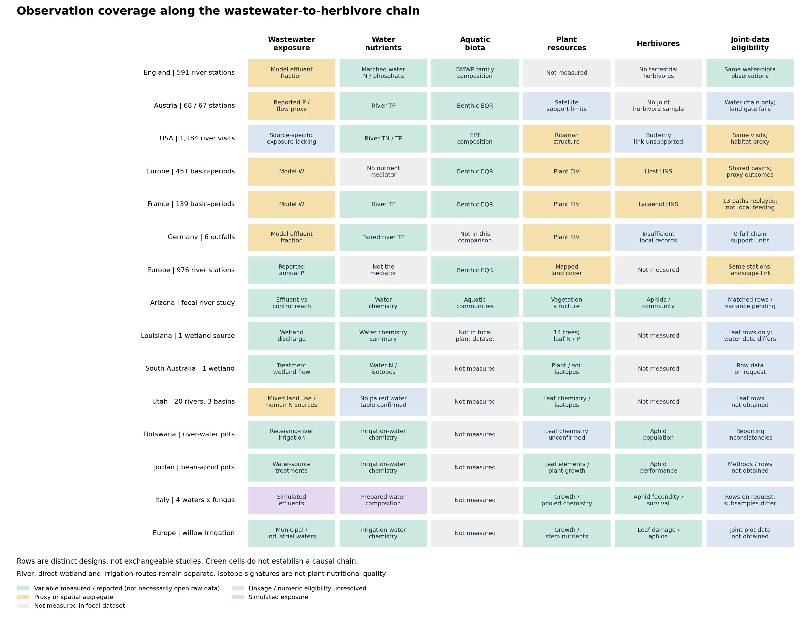

# 水域と陸域を同じ問いに配置する：観測範囲の統合図

[PDF](figures/GLOBAL_CHAIN_COVERAGE_20261120.pdf)・[編集可能なSVG](figures/GLOBAL_CHAIN_COVERAGE_20261120.svg)・[セルごとの判定と出所](evidence/GLOBAL_CHAIN_COVERAGE_20261120.json)

## 図の読み方

下水曝露、水中栄養、河川生物、植物資源、植食者、同一観測として統合できるか、の6項目で既存解析と外部候補の15設計を比較する。緑はその変数の測定・報告、黄は代理指標・空間集約、灰は当該データで未測定、青は対応・取得・数値利用条件が未解決、紫は調製した模擬曝露。**緑は正の効果や因果的支持を表さない。** 同じ行に緑が並んでも、地点・期間・個体の対応、対照、交絡の識別が必要である。

15設計は独立15研究ではない。欧州・フランスは標本を共有し、欧州ヤナギ実験は複数国・異なる排水源をまとめて表示している。網羅的レビューの研究数やメタ解析の分母として使わない。灰は当該解析での欠測であり、その地域で測定例が一切ないという意味ではない。報告負荷は実到達量ではなく、同位体値は植物の栄養品質ではない。

## 共通の問いと現在の結論

共通の問いは、**下水が変える受水環境のうち、どの成分が河岸植物の資源量・品質へ変換され、その変化が植食者まで伝わるか**である。河川生物は受水環境の応答を、植物・植食者は陸域への接続を担う。河川生物を蝶の餌資源とする矢印は置かない。

既存の広域解析は水域内の応答と植物–潜在寄主構成を検証しているが、代理指標と局所的な利用との間に隔たりがある。一方、外部の湿地・灌漑研究には植物成分や植食者の実測があり、接続機構を検討する資料になる。ただし自然河川経由・直接湿地放流・灌漑を区別しなければ、下水→河川→河岸という主鎖の検証にならない。

したがって、既存の広域関連を位置づける第一層、同じ受水環境と植物を測る第二層、植物と植食者を操作・測定する第三層として統合する。これは証拠の配置であり、別層の係数から新しい全鎖効果を計算することではない。現在の資料では全鎖の定量実証は未達である。

図は[経路別効果とスケールの表](PATH_EVIDENCE_SCALES_20261120.md)、[原本を確認した候補](GLOBAL_PLANT_HERBIVORE_SOURCE_SEARCH_20261120.md)、各行に対応する監査文書を参照して作成した。既存結果の正負・信頼区間は効果表に残し、この図で測定範囲と混同しない。PNGを開いて表示を確認し、同じ描画からPDF/SVGを出力した。生成：`python analysis/20261120_chain_source_audit/render_chain_coverage.py`。
