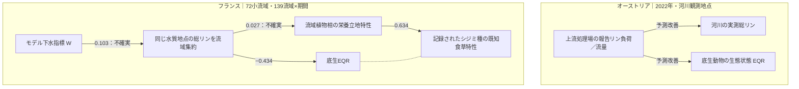
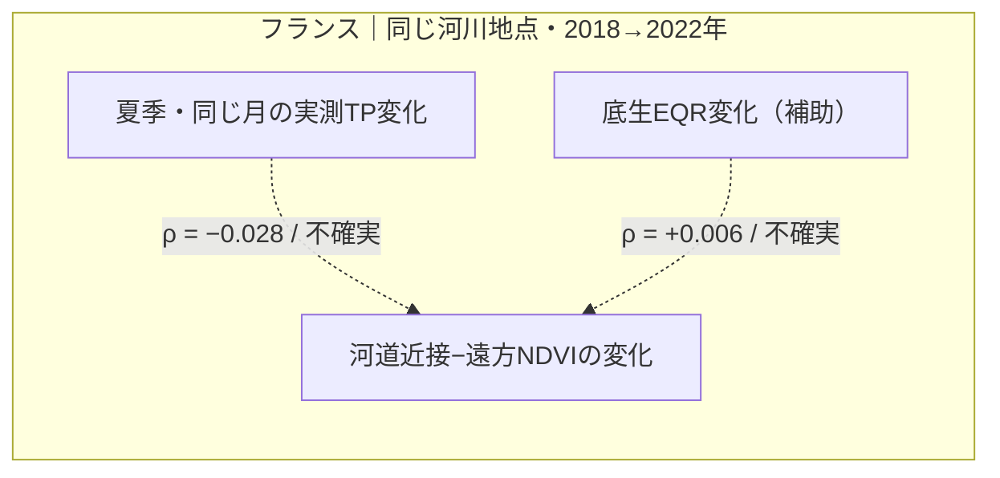
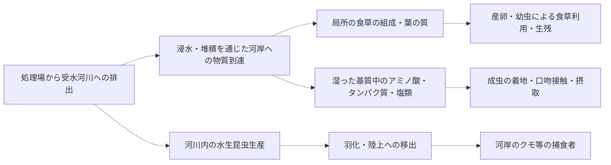

# 下水排出の生態影響は河岸を越えるか――河川水質と陸上の植物・植食者の対応

## 要旨（論文草稿）

都市下水は水・栄養塩・有機物などを河川へ方向性をもって供給するが、その関連が河川内の生物状態から河岸の植物・植食者まで一つの経路として検出できるとは限らない。本研究では欧州の報告排出負荷・実測水質・底生動物、河畔土地被覆、植物相と蝶類の既知食草特性を、それぞれの真正な観測単位で比較した。フランスの共通139小流域×期間ではTPと底生状態EQRの負の関連（標準化係数−0.434）、植物相とシジミの既知食草特性の正の関連（+0.634）が観測されたが、TPから植物相への係数は不確実（+0.027）で、下水指標から食草特性までの係数積も0を含んだ。欧州の2018年同一河川976地点では周辺土地被覆が底生状態の予測を補助した一方、近接・遠方の植生被覆差の追加情報は乏しかった。さらに、フランス同一河川地点における2018→2022年の同じ夏季観測月の実測TP変化と、真正河道20～100 m対500～1,000 mのNDVI差の変化は、**事後的な2シーン雲補完を用いた探索的122地点**では相関しなかった（44小流域、22親流域、Spearman ρ=−0.028、親流域再標本化95%区間［−0.436,+0.316］）。元の単一シーン検定は品質不足で停止しており、完全ケースの水質にも偏りがある。**EEAの2018年上流WWTP報告リン排出量が正だった地点は、元263地点中1地点・河道と観測月が揃う178地点中1地点だったが、この122地点では0地点だった。** これは下水が存在しないという意味ではなく、報告された下水負荷による水陸効果を同標本で識別できないことを示す。これらの結果は、水域内・陸域内の環境構成の対応を示すが、下水由来栄養塩の水陸移行、現地幼虫摂食、成虫の基質利用や水生昆虫の羽化補助を直接実証するものではない。**水陸連結の成立・不成立を断定するのではなく、連結のどの段階が現在のマクロ観測で識別できるかを特定した。**

## 序論

下水処理場から河川に放出された窒素やリンは、どのような条件で河岸の生物にも影響するのだろうか。**その水陸間移行そのものは未発見の現象ではない。** 2025年には、下水影響河川での水生昆虫・河岸クモの安定同位体・微生物叢からの移行が報告され、2026年には8下水処理場の上下流で水生昆虫から河岸クモへのマイクロプラスチック移行が示された。したがって本研究の問いは「水陸間移行が初めて存在するか」ではなく、「局所研究で観測された経路が、広域の異なる環境・生物群・スケールでどこまで識別できるか」である。[2025年の下水–水陸食物網研究](https://doi.org/10.1016/j.envpol.2025.125948)・[2026年の8処理場研究](https://doi.org/10.1016/j.envpol.2026.129116)河道内では、排出口と観測地点の上下流関係をたどり、処理場の報告負荷を河川流量、水質、底生動物群集の状態と照合できる。河岸の植物が同じ栄養塩に接する機会は、水と堆積物が河道の外に運ばれる頻度や範囲にも左右される。ドイツのムルデ川では、洪水後の氾濫原草地で、植生上や地表に堆積した土砂とそこに含まれる窒素・リンが実測されている。このような水陸間の輸送が放流を受ける河川でも生じるなら、水中の栄養濃度の違いが、河岸に生育する植物の種構成にも表れる可能性がある。[ムルデ川氾濫原での堆積物と栄養塩の調査](https://pmc.ncbi.nlm.nih.gov/articles/PMC8638890/)

植物の種構成が変わると、その場所で植食者が利用できる餌の種類も変わる。たとえば、富栄養な立地を好む植物の割合が高い場所では、そうした植物を食草とする植食者が群集に占める割合も高いと予想される。ただし、この対応は、放流水が河岸に届いた場合にも、農地や市街地を含む流域景観が植物と植食者の双方の分布に関わる場合にも生じうる。両者を吟味するには、排出口の上下流で実測水質と植物相が対応するかという局所的な問いと、同じ流域にどの植物と植食者が分布するかという広域的な問いを、それぞれの観測単位で検討する必要がある。

この二つ目の問いを調べるうえで、蝶類には、幼虫が利用する食草が種ごとに記載されているという利点がある。各流域に記録された植物が好む立地と、そこに記録された蝶の既知の食草が好む立地を、共通の植物指標で比較できる。そこで本研究では、アゲハチョウ科、シロチョウ科、タテハチョウ科、セセリチョウ科、シジミチョウ科の5科を対象とした。群集全体の食草特性に流域間の違いがあれば、科ごとの記録割合が変わることで生じたのか、それぞれの科の内部で異なる食草を利用する種の構成が変わったのかを区別できる。この比較で捉えるのは、出現した種から推定される食草利用の可能性であり、個々の幼虫の摂食には別の観察が必要となる。[欧州の蝶類の幼虫食草目録](https://doi.org/10.1002/ece3.10834)

科内の種構成を詳しく検討する例として、シジミチョウ科に着目した。同科には、幼虫が利用する食草の栄養立地特性が同属種の間でも異なる例があり、流域の植物相との対応を種の違いに即して検討できる。一方、水辺に成虫が出現する理由は幼虫の食草だけでは決まらない。熱帯の野外実験ではシジミチョウ科の雄がアルブミンを含む餌に誘引されており、湿った基質を利用するための飛来も考えられる。したがって本研究では、科内の食草特性と植物相の対応を検証し、成虫が河岸で利用する資源については、出現記録から識別できない別の経路として扱う。[Beck et al. 1999](https://pubmed.ncbi.nlm.nih.gov/28308154/)

以上を踏まえ、欧州の河川を対象に、上流処理場の報告負荷が河川の総リン濃度と底生動物群集の状態にどう対応するかを調べた。次に、同じ排出口の上下流で、水中の総リンと周辺の植物の栄養立地特性に整合した差が現れるかを検討した。最後に、水質、植物、蝶の記録が重なる小流域では、河川の総リンと流域の植物相のそれぞれが、シジミチョウ科の記録割合と科内の食草特性をどこまで予測するかを比較した。こうした比較を通じて、河川内で捉えた下水関連の勾配と、陸上の植物・植食者の対応を結ぶ経路のうち、どの区間に観測上の支持があるかを評価した。さらに、水域と陸域で異なる観測時空間を比較することによる曖昧さを減らすため、フランスの同一河川地点・同一夏季観測月の2018年と2022年の実測総リンと、河道からの距離別の衛星植生指数（NDVI）を直接対応させた。この最も厳密な水陸間の共変動検定も、独立した標本・解釈上の制限を明示して含める。

## 図1　観測済みの関連・水陸境界の検証・未観測の資源経路を分ける

**A　同じ標本内の統計的な経路。** 各枠は別の標本。矢印はモデル上の予測方向を表す。フランスの数値は標準化係数で、オーストリアの予測改善率とは単位が異なる。

Aの底生EQRとシジミの間の無向点線は、同じ流域での条件付き関連の点検（係数 −0.112、区間はゼロを含む）を示す。底生群集は水域側の生態応答である。

**B　水域・陸域を同じ河川地点と同じ夏季観測月で結んだ検証。** 2018→2022年の実測TPと、河道線から20～100 mのNDVIから500～1,000 mのNDVIを引いた差の変化を比較した。点線は「検証したが明確な連動が見られない」関係を示し、生物が移動した経路を意味しない。

元の単一衛星シーンの品質基準は**116/178地点で事前基準120地点に届かずSTOP**。さらに、2018年のEEA上流WWTP報告リン負荷が正の地点は、元263地点に1地点、選定済み178地点に1地点、実画素が揃った122地点には**0地点**だった。2018年報告負荷の未検出は下水実在の不在ではなく、2022年の移行量の不在でもない。この標本のTPは、下水に特異的な実際の到達量ではない。事前に候補として選ばれていた同月2シーンの雲補完を*事後的な技術的感度解析*として行った場合に限り、**122地点・44小流域・22親流域**で上の比較を実行した。主たる元検定の不合格判定を取り消さず、未検出を「移行が存在しない」と読まない。[実測河川・衛星解析の原本検証](evidence/fr122_same_station_TP_NDVI_2018_2022.csv)・[詳細と原本Actions](https://github.com/zuizui0223/gesui/blob/analysis/gesui-20261117-onepaper-pathway-identification-decision/docs/RESULTS_20261117_FR178_TRUE_RIVER_122_POSTHOC_MOSAIC_MEASURED_JJA_TP_NDVI_NULL.md)

**C　河岸で成立しうる、しかし今回直接測定していない相互作用。** 下の破線は仮説的な資源移動であり、Aの流域平均・BのNDVIを、局所的な栄養流入量や摂食量に置き換えない。

水生昆虫の羽化→河岸の捕食者という経路は、植物→幼虫の食草経路とも成虫の吸水・湿潤基質利用経路とも区別する。実際の羽化量やクモへの資源移行は、今回のフランス122地点では測定されていない。

## 本文の骨子

**方法。** 排出源と水質・底生状態を河川地点で結んだ標本、排出口の上下流の対応標本、水域と陸域を共通の小流域に集約した標本を用いる。フランスの水質・EQRは2018年と2022年の反復地点、植物・蝶はそれぞれ2017–19年と2020–22年の出現記録。調整付き回帰式を同一139行に適用し、24上位流域を単位に3,000回再標本化して全式を再推定した。以下の95%区間は探索的。別地域の係数を掛け合わせない。[フランスの元標本](https://github.com/zuizui0223/gesui/pull/114)

**同一河川・同一月の二時点比較。** 別のフランスの元263同一水質・底生観測地点から、真正河道への位置適合と両年の夏季実測TP観測機会だけで178地点（58 H7・23 H6）を固定した。河道に沿う±500 mの区間で、水際20～100、100～250、250～500、500～1,000 mの4帯それぞれに有効10 m自然被覆画素100以上、両年で同一暦月2か月以上を要求した。単一シーンでは116地点のため主解析はSTOP。事後的な雲補完（事前選択した同月最大2シーン、共通投影格子・反射率オフセット補正）による122地点だけを探索的に評価した。場所×時点を一致させたTP–NDVI検定と、広域小流域の植物–蝶構成検定は**異なる標本・異なる被説明変数**として別々に扱い、係数を一つの因果パスとして掛け合わせない。[方法・source品質](https://github.com/zuizui0223/gesui/blob/analysis/gesui-20261117-onepaper-pathway-identification-decision/docs/RESULTS_20261117_FR178_TRUE_RIVER_S2_116_SITE_STOP_PIXEL_SOURCE_DIAGNOSTICS.md)

**結果1　排出源から河川内まで。** 欧州では2018年と2022年の双方で、年間報告N/P負荷がEQRの地域外予測を約1%改善した。オーストリア68地点では、上流報告P／流量を加えると実測TPとEQRの予測誤差がそれぞれ16.30%、19.27%減少した。位置を精査した67地点でも、実測TP・周辺土地被覆・排出報告の有無を考慮したEQR予測が10.44%改善した。P／流量は希釈を仮定した排出指標で、到達量や特定化学種の効果は識別していない。[欧州2018](https://github.com/zuizui0223/gesui/pull/17)・[欧州2022](https://github.com/zuizui0223/gesui/pull/14)・[オーストリア](https://github.com/zuizui0223/gesui/pull/118)

**結果2　排出口近傍と河岸景観の対応を点検する。** ドイツ6排出口では、2011–22年の同月の上下流TP差と、河川沿いの地点を中心とする半径1 kmの植物相を照合できた。両側の植物形質の記録条件を満たした4排出口すべてで下流側の植物栄養立地スコアは低かった。うち1排出口では、TPが下流で2.083倍でも植物スコア差は−0.978。残り3排出口ではTPも下流側で低い。水質地点は排出口から7–25 km離れ、直接水のかかった植物個体は追えていない。欧州976地点で周辺250–500 mの土地被覆がEQR予測を3.42%改善した結果も、景観と河川状態の空間対応として示す。[排出口別の全6対](evidence/DE6_interface_contrasts.csv)・[ドイツの採集設計](https://github.com/zuizui0223/gesui/pull/7)・[欧州の土地被覆](https://github.com/zuizui0223/gesui/pull/123)

**結果3　同じ河川・同じ夏季観測月で水陸の変化を比較する。** フランスの実測TP・I2M2 EQRが2018年・2022年に同じ地点で観測された263地点のうち、真正河道と夏季観測月の条件から178地点を固定した。事前に定めた単一シーンの品質基準は116/178で未達。別の事後的な雲補完法を使うと、122地点（44 H7、22 H6）で河道から20～100 m対500～1,000 mのNDVIを2018→2022年の同一夏季月で比較できた。実測TPの変化と相対NDVIの変化のSpearman相関は**ρ = −0.028**、22親流域を再標本化した記述的95%区間は**［−0.436, +0.316］**。土地利用・流量・流域面積・2018年NDVIを含むモデルにTP変化を追加しても、親流域留保のMSEは**−3.73%**しか「改善」せず、実際には悪化した（記述的95%区間**［−9.19%, +2.25%］**）。同じ標本の底生EQR変化とNDVI変化も**ρ = +0.006**で連動を検出できなかった。ただしEQRの測定日は必ずしも同じ夏季月ではない。衛星合格122地点は不合格56地点よりTPが高い傾向があり、完全ケース解析の選択バイアスを考慮する必要がある。さらに**元2018年の上流WWTP報告リン負荷が正の地点は、この122地点中0地点**である（元263地点1件→位置・観測月適格178地点1件→画素適格122地点0件）。唯一の報告陽性地点は、2022年6月・8月の河道から20～100 mの有効画素がそれぞれ79・78（基準100以上）となり、2か月の必須条件を満たさなかった。ゆえに**今回のTP–NDVI非検出は下水特異的な水陸波及効果の検定ではない**。未報告排水の可能性を認めつつ、原本で確認できる源報告陽性の比較が成り立たないことを明示する。[元263→178→122の源データ照合](evidence/fr122_2018_upstream_WWTP_report_support_audit.csv)・[方法と欠測原因](MACRO_PATHWAY_IDENTIFICATION_LITERATURE_AND_POSITIVITY_AUDIT_20261117.md)。これは広域の共通環境勾配が直接的な水陸資源移行として現れたことを示す結果ではない。[源原本と予測検証](evidence/fr122_same_station_TP_NDVI_2018_2022.csv)・[実行済み解析](https://github.com/zuizui0223/gesui/actions/runs/44020568960)

**結果4　蝶群集全体から科内の構成へ。** 欧州454流域×期間で、モデル下水指標に沿った蝶5科の平均食草スコアの傾きの約96%が、各科の内部で記録される種の違いに由来した。シジミ科で十分な記録のある426行では、同指標による科内食草スコアの予測改善が14.62%。科ごとの観測条件は異なり、科別の形質ラベル検証は多重補正後に不確実。早期に成虫の生態からシジミに着目しており、5科から初めて発見された唯一の応答科とは扱わない。独墺の写真記録割合の初期陽性は前年調整で弱まった。さらに**別のMOIST（湿潤立地特性）解析**では、植物相と蝶の既知食草特性の予測対応が属間組成によって大きく説明され、属内の追加予測改善は+3.54%［−2.99%, +9.33%］、植物の属内で形質ラベルを入れ替えた帰無検定は片側p=0.0678だった。このMOIST結果を本段落のNUTRI（栄養立地）効果の直接追試とみなしてはならないが、形質資料の共有・植物属の入れ替わり・地理的交絡を区別する理由になる。[MOIST属間・属内の原本検証](https://github.com/zuizui0223/gesui/blob/analysis/gesui-20261117-strict-moisture-genus-adversarial/docs/RESULTS_20261117_ORIGINAL_MOIST_GENUS_ADVERSARIAL.md)。[当初の仮説](https://github.com/zuizui0223/gesui/pull/20)・[5科の分解](https://github.com/zuizui0223/gesui/pull/94)・[科内の結果](https://github.com/zuizui0223/gesui/pull/95)・[科別検証](https://github.com/zuizui0223/gesui/pull/101)・[写真割合の感度分析](https://github.com/zuizui0223/gesui/pull/26)

**結果5　同一小流域で経路を接続する。** フランス共通標本ではTPと底生EQRの係数は−0.434［−0.654, −0.279］、植物相とシジミの食草特性の係数は+0.634［+0.116, +0.880］。その間のTPと植物相の係数は+0.027［−0.170, +0.229］。W→TP→植物相→食草特性の係数積は+0.002［−0.030, +0.038］。共有流域上では二つの区間に対応があるが、連鎖全体の間接効果は特定できなかった。植物相と食草の指数には共通する立地形質資料が使われる。植物相の追加で種均等の食草スコア予測は18.19%改善した一方、シジミの5科中の記録割合では改善が見られなかった。[全式の係数と区間](evidence/fr_interface_paths.csv)・[地域留保・時間差の結果](evidence/fr_lyca_water_land.csv)

## 外部原本で観測された水陸間移行（本研究の独立した新規実証ではない）

河川水から陸域へ移る物質を実際に測った局所的な先行研究は、衛星NDVIとは異なる答えを与える。2026年のカナダGrand River研究は8下水処理場の上下流で水生昆虫幼虫・羽化成虫・河岸のクモを測定しており、別研究者の[公開Borealis原本906試料](https://doi.org/10.5683/SP4/U0MN9S)を、処理場×調査時点×分類群で再集計したところ、河岸のTetragnathidaeクモでは**8/8処理場で下流のマイクロプラスチック濃度が高かった**（元処理場ごとの中央値濃度比**1.69倍**、処理場を等重みとした下流−上流差+0.00867粒子/mg）。Hydropsychidae幼虫も8/8（濃度比中央値1.62倍）、同科成虫は6/8で下流側が高かった。一方でChironomidae幼虫は3/8でしか下流側が高くなく、成虫の厳格な測定支持は5/8処理場で閾値を下回った。したがって、**実際の水陸間物質の変動は、物質の種類と昆虫の分類群・生活史段階に依存する可能性がある**。これはすでに原著が検討した現象のデータ再計算であり、新たに8流域で独立実験した結果ではない。[原著 Wardlaw et al. 2026](https://doi.org/10.1016/j.envpol.2026.129116)・[原本を検証した比較と支持数](GRAND8_SOURCE_VERIFIED_LARVAE_ADULT_SPIDER_UPDOWN_MICROPLASTICS_20261117.md)

別の2025年Bow River下水研究の公開安定同位体データでは、5河川地点（上流曝露なし3・曝露あり2）で水生幼虫・成虫と河岸クモのδ¹³C・δ¹⁵Nが共に測定されている。原著184試料の再集計ではTetragnathidaeクモのδ¹³Cは曝露2地点で非曝露3地点より平均+3.14‰であったが、葉のδ¹⁵Nによる地点内基準差は同方向に単純ではなかった。**同位体の栄養源指標とプラスチック粒子の濃度は同じ効果量として統合しない。** これら先行研究の本当の局所食物網・曝露条件と、フランス122地点の下水源報告陽性0/122・TP–NDVI非検出との違いこそ、広域で検出可能な経路を考える出発点となる。[Bow原著と公開データ](https://doi.org/10.1016/j.envpol.2025.125948)・[source再解析](https://github.com/zuizui0223/gesui/actions/runs/44103188904)

**Grand Riverの8処理場は同一水系内で相互独立の8河川ではない。公開原本6表と原著の年次情報を突合すると、同じ年の排水・水生幼虫・成虫・河岸クモが2回以上の調査で揃うのは8処理場中4処理場だけだった（Ayr・Caledonia・Guelph・Preston）。元の6/8施設という全経路の観測基準に届かないため、排水濃度→幼虫→成虫→クモの定量的な媒介モデルはSTOPとした。** 既存の8施設における上下流差は有効だが、たとえばHydropsychidae幼虫とTetragnathidaeクモの**施設別の下流−上流増加幅**はSpearman ρ=−0.643、同科成虫とクモではρ=−0.262であり、双方の濃度が下流側で高くても増加量は比例しなかった。さらに下流/上流の濃度比を比べると、クモの相対増加がHydropsychidae幼虫より大きい施設は4/8、Heptageniidae幼虫より大きい施設は3/8だった。これは食物連鎖による生物濃縮係数ではなく、同じ施設での**測定指標間の応答の不一致**を表す（いずれも事後的・記述的、1水系8地点）。[年×調査回のsource-only照合と施設別共応答](GRAND8_20261118_CHRONOLOGY_AND_CROSS_STAGE_COGRADIENT.md) 下水の窒素・リンが河岸の植物やシジミに届く量の証明にも使わない。

**別流域・別物質の参照系として、米国USGSのFarmington River水系5支流のPFAS原本も追加検証した。** 実測PFAS分析表3,192行は12化合物×試料（品質管理空試料8件を含む）であり、真の河川水・堆積物・昆虫・クモ等の実試料は258件、別表に昆虫質量128件と同位体76件がある。5支流すべてで水・水生幼虫・羽化成虫・河岸クモが測定されているが、**5支流は同じ集水域内で、下水処理場の曝露群ではない**。同位体から同年の幼虫・成虫・クモが2件以上揃うのは2/5支流・年にすぎず、元個体IDで化学分析と同位体を直接結べたのは10件のバイオフィルム試料のみだった。未対応の異なる個体の値を疑似的に1個体へ結合しない。原著Campbell et al.（2026）はすでに5支流のPFAS食物網モデルを公表しており、本稿の新規独立発見ではない。[USGS原本](https://doi.org/10.5066/P139C2SN)・[データ粒度・年・試料IDの検証報告](FARMINGTON_USGS_5STREAM_REAL_PFAS_SOURCE_YEAR_SPECIMEN_MATCH_20261118.md)。

## どの接続が未観測か

| 接続 | 標本・空間単位 | 現在の判定 |
|---|---|---|
| 報告負荷 → 水質・底生状態 | オーストリアの同一河川地点・同一年 | 予測関係あり。実際の排出由来割合や河岸への到達は未測定 |
| 水質 → 陸上植物 | ドイツ排出口ペア、フランス小流域 | 上下流差・調整付き回帰を検証。河岸への物質移動、葉の化学組成、洪水直後の応答は未観測 |
| 実測水質の時間変化 ↔ 河岸植生指数の時間変化 | フランス同一河川122地点・2018→2022年・同じ夏季暦月（事後的雲補完の探索標本） | ρ = −0.028、TP追加の親流域外予測改善−3.73%。連動は検出できず。元の単一シーン116地点は事前品質条件未達。**2018年のWWTP上流報告P陽性0/122で源特異的効果は識別不可** |
| 植物相 → 蝶 | 欧州・フランスの小流域×複数年 | 出現種の食草特性との空間対応あり。現地の産卵・幼虫の摂食・生残は未観測 |
| 同じ排出口の植物 → シジミ群集 | 別の欧州16排出口、河道上で上下流各1.5 km・各半径1 km | 2020–22年に両側で植物20件以上かつシジミ1件以上が3排出口。両側の科内食草構成を評価できた排出口は両期間とも0。オーストリア67水質地点と蝶パネルの地理的重複も3小流域4地点。[地点設計](https://github.com/zuizui0223/gesui/pull/115)・[67地点の重複台帳](evidence/AT67_basin_overlap.csv) |
| 河岸基質 → 成虫摂食 | 仏・独・墺、2017–22年の指定されたiNaturalist吸水基質欄 | 当該欄の記録は0。基質のタンパク質・塩類、口吻接触、下水由来成分の摂取のいずれも今回の排出口で未測定。記録の欠如から行動の不在は推定できない。[国・年別照合](evidence/adult_substrate_coverage.csv) |

**成虫の出現をどう読むか。** 食草カタログは幼虫が利用しうる植物を示すが、水辺で観察された成虫には、その場へ飛来して湿った基質を利用する個体も含まれうる。熱帯のシジミチョウ科の雄がアルブミン餌に誘引された実験は、食草を介する経路と成虫自身の資源利用を区別する理由になる。この第二の経路は図1Cの仮説であり、本研究では餌の成分と摂取行動を測定していない。[Beck et al. 1999](https://pubmed.ncbi.nlm.nih.gov/28308154/)

**考察の結び。** 本研究で最も不確かな接続は、河川水中の変化が、河岸で植物や成虫が実際に使う資源の変化へ変換される区間である。水域内の実測TP–底生状態、陸域内の植物相–蝶の既知食草特性には観測上の対応がある。しかし同じ河川・同じ夏季観測月に時空間を揃え、河道からの距離で陸域指標を測っても、TP変化と河畔NDVIの近遠差変化の連動は検出できなかった。これを水陸資源輸送が存在しない証拠とみなさない。そもそも厳格な122地点の同年源報告陽性サポートはないため「下水からの伝播なし」とも結論できない。2025–26年の直接的な水陸移行研究を踏まえれば、広域的に一般化できる条件こそ未解決である。観測しているNDVIと未観測の物質輸送・葉質・羽化昆虫・成虫基質摂食を区別することで、どの段階に直接観測が必要かを特定できる。[先行研究・マクロ指標・曝露識別性の監査](MACRO_PATHWAY_IDENTIFICATION_LITERATURE_AND_POSITIVITY_AUDIT_20261117.md)。米国で実測された水生昆虫羽化量は水陸移動の別の実例だが、欧州の同じ排出口・蝶の利用記録と接続していない。[羽化量の別標本](https://github.com/zuizui0223/gesui/pull/61)

本稿は2026年11月17日時点の既存解析の統合案。添付CSVは既存の集計出力、または原本のGitHub Actions実行結果から対応する同一地点・同一月・サンプル品質の指標を転記した検証台帳であり、新たな独立フィールド観測ではない。各パネルの推定量・観測単位・年の違いを保持したまま提示する。`main`には未統合のDraft。
