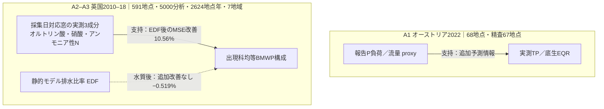
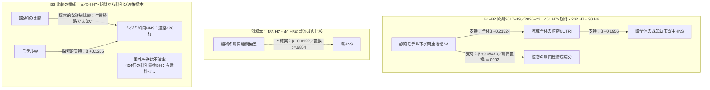
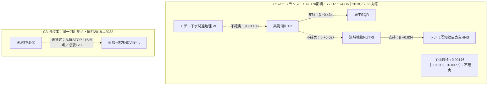
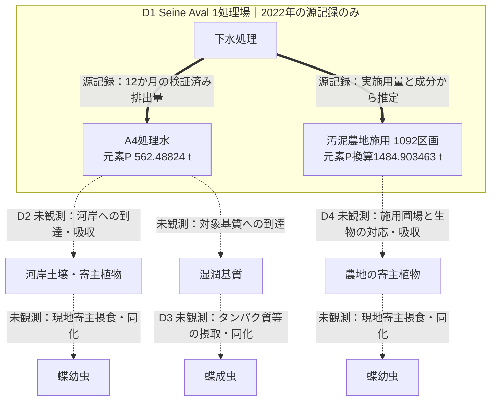

# 下水に関連する水域・植物・蝶の構成と、水陸間接続の限界

**2026年11月21日・解析終了：** [指導教員確認用の要旨と最終3図](REVIEW_PACKAGE_ABSTRACT_THREE_FIGURES_20261120.md)。[最後の人口感度解析](POPULATION_FINAL_SENSITIVITY_20261120.md)では、人口集積から独立したWの正の情報は不確実だった。元の人口未調整の肯定結果と併記する。

2026年11月20日改訂。本文には既存PR #132–136、蝶5科の原比較、初期の局所植物・写真・EEA底生の追試と限界を統合した。#136は源接続の候補監査で、生物効果の追加ではない。以下の進行中検証には既存解析の再実行と外部データ監査を別途記録している。

- [論文本文](MANUSCRIPT_FULL_20261119.md)
- [実行前固定の欧州451行確認：景観調整後もW―蝶の関連と予測情報が残る](EU451_W_LANDSCAPE_CONFIRMATION_20261120.md)
- [表1：各経路のスケール・支持・不確実性・未観測量](PATH_EVIDENCE_SCALES_20261120.md)
- [図1の日英キャプション](FIGURE1_LEGEND_AND_BOUNDARIES_20261119.md)
- [既存主張の監査と停止結果](CLAIM_EVIDENCE_LIMITS_20261119.md)
- [補足解析・SOURCE-STOP](SUPPLEMENTARY_ANALYSES_AND_SOURCE_STOPS_20261119.md)
- [目標全体の達成状況・未完事項](GOAL_EVIDENCE_AUDIT_20261120.md)

## 水陸の同調を問う新規検証（2026年11月20日）

- [共通要因の分解・親流域除外・未使用親流域への予測](WATER_LAND_SHARED_DRIVERS_20261120.md)：耕地を含む景観勾配への共通応答を支持。景観は水域・陸域両指標の留保予測を改善するが、W追加の予測改善は不確実。

この段階の目標は、水域と陸域の指標を同じ流域・期間にそろえ、空間的な共変動と時間的な同調を区別して、下水関連指標と景観条件の説明寄与を検証することである。[解析結果・再現コード・図](WATER_LAND_COVARIATION_20261120.md)。フランス73流域・24親流域では、水生昆虫の生態状態と植物相に空間的対応が認められたが、景観調整後には弱まり、下水指標の独自の説明寄与と2期間の同調変化は不確実だった。以下の全鎖検証は以前の目標の記録であり、その完了を意味しない。

## 広域統合検証の履歴（2026年11月20日）

研究目標を「下水→河川の栄養環境→周辺の植物資源→植食者の連鎖を実証できるか」に設定した。下記は本文で実証済みと扱う結果ではなく、既存結果の統合設計と新しい原本候補の調査である。

- [マクロ解析／メタ解析の統合設計、既存接点の再評価](CHAIN_INTEGRATION_PROTOCOL_20261120.md)
- [世界の植物・植食者に近い原データ候補と原本確認状況](GLOBAL_PLANT_HERBIVORE_SOURCE_SEARCH_20261120.md)
- [Hammond葉N/PとN添加メタ解析の原本・独立性監査](CHAIN_SOURCE_AUDIT_HAMMOND_NIMPACT_20261120.md)
- [南豪州・Utahの水–河岸植物の対応と公開範囲](WATER_PLANT_SOURCE_COVERAGE_20261120.md)
- [処理水–植物–植食者の灌漑比較実験](IRRIGATION_COMPARATORS_20261120.md)
- [汚泥施用と昆虫：直接証拠・取得資料](SLUDGE_INSECT_DIRECT_EVIDENCE_20261120.md)（Virginia資料は別の野外研究候補として保存し、本論文の生態解析から除外）
- [成虫の窒素・Na利用の種間差と、下水への検証予測](BUTTERFLY_ADULT_NUTRIENT_MECHANISMS_20261120.md)
- [Arizona：水質・河岸植物・アブラムシを扱う同一研究と反証](ARIZONA_CHAIN_SOURCE_20261120.md)
- [Italy：植物–アブラムシ実験の個体対応と数値利用判定](TROTTA_EXPERIMENT_ELIGIBILITY_20261120.md)
- [既存129 PRの出所スナップショット](PR_SOURCE_SNAPSHOT_20261120.json)（独立129研究を意味しない）
- [全129 PRの照合・レビュー系列と重複を避ける統合単位](PR_DEPENDENCY_INTEGRATION_20261120.md)
- [フランス共通139行・13経路の再実行と同時不確実性](FR139_REPLAY_AND_INTEGRATION_20261120.md)
- [局所放流点の再現・全鎖の観測機会・流域結果との統合判定](LOCAL_INTERFACE_INTEGRATION_20261120.md)
- [広域統合図：15設計の実測・代理指標・未観測・取得待ち](GLOBAL_CHAIN_COVERAGE_FIGURE_20261120.md)
- [ガーナ農地：公開数値、植食者の結果、地域と水源の交絡](GHANA_SOURCE_ELIGIBILITY_20261120.md)

上記の外部資料監査では新しい全鎖効果を推定していない。今回の水陸共変動解析は別途実施した探索的解析である。同一源・地点・期間で完全鎖に近い標本を優先し、部分経路の異なる研究を掛け合わせた因果連鎖は作らない。

## 要旨

下水に関連する環境勾配は、河川の生物群集だけでなく、周辺の植物資源と陸域の植食者の構成にも対応する可能性がある。しかし、下水関連の信号を人口集積や土地利用から区別し、水域と陸域の応答を結び付けられるかは明らかでない。本研究では、欧州の232小流域・451流域×期間について、下水関連のモデル指標、植物の栄養立地嗜好、蝶5科の既知幼虫寄主の栄養立地嗜好を統合し、景観・観察条件を調整した関連と親流域を留保した予測を評価した。さらに、別製品の人口格子を上流流域へ集約した固定感度解析と、フランス73小流域における水域・陸域指標の並列比較を行った。

欧州では、耕地・都市・面積・流量等を調整した後も、下水関連指標が高いほど蝶群集が富栄養な立地の植物を寄主とする種に偏り、下水指標の追加は予測誤差を7.98%減少させた。ただし、人口照合の品質条件を満たした437行の同一標本では、上流人口密度を加えると係数は+0.0815から+0.0310へ弱まり、人口調整後の95%区間は−0.0158〜+0.0778、追加予測改善は0.98%［−3.56, +7.12］と不確実になった。フランスでは、水生昆虫の低い生態状態と植物の高い栄養立地嗜好が空間的に対応したが、景観調整で弱まり、2期間の同調変化は支持されなかった。植物相と蝶の寄主特性の空間的対応は残った。英国・オーストリアの水域結果は、化学環境や処理場関連指標の予測情報を示したが、蝶への曝露の妥当性や水陸間の物質移行を検証するものではなかった。

以上より、下水関連地理と蝶の資源利用特性の対応は認められる一方、人口集積から独立した下水の作用は現在の広域指標では識別できなかった。水域と陸域の空間的対応を、河川から陸への物質移動やその不在とは区別する必要がある。汚泥施用や成虫の栄養利用は、この研究では未測定の経路である。

## 補足概念図｜下水に関連する群集構成と水陸間接続の証拠

表示確認済みの画像：[A 水域](figures/FIGURE1A_20261120.png)・[B 陸域](figures/FIGURE1B_20261120.png)・[C 共通標本の接続](figures/FIGURE1C_20261120.png)・[D 源と未観測経路](figures/FIGURE1D_20261120.png)。以下のMermaid原図から出力した確認用図版で、投稿用の最終レイアウトではない。[出力記録](evidence/FIGURE1_RENDER_RECEIPT_20261120.json)。

**凡例：** 実線「支持」は統計的関連・予測情報への支持、太線「源記録」は報告された排出・施用の数量記録。点線には必ず「不確実」「未観測」「STOP」を文字で付す。実線も因果効果や実測の生物間物質フラックスを意味しない。枠ごとに標本が異なり、枠を跨いで係数を掛け合わせない。各IDは[表1](PATH_EVIDENCE_SCALES_20261120.md)に対応する。

### A｜水域：負荷・化学環境と底生動物

A1とA2は独立の標本・応答である。英国の水質はTP/TNではなく、水質起源の同定も因果媒介もしていない。負のMSE改善は予測悪化を示す。

### B｜陸域：植物を介して蝶全体から科内構成へ

植物NUTRIは葉窒素ではなく、HNSは現地摂食量ではない。451行のW→植物属内成分と183 H7の植物属内成分→蝶は異なる検定である。451行の国外予測は不確実であり、H7記録を河岸限定の群集とは呼ばない。454→426という解析の焦点化は、植物→植食者の物質移行を示す矢印でも、研究全体の発想の時系列でもない。シジミへの仮説上の関心は5科HNS比較より前に存在した。

### C｜接続の主検証：同じフランス標本内でどこまでつながるか

実線は同じ139行内の条件付き関連であり、物質移行の証明ではない。TP→植物が不確実なことを別国の正の結果で補完しない。衛星比較のSTOPをゼロ効果と描かず、事後122地点の結果は補足S1に限定する。

### D｜源の二経路と、その先で未観測の生物利用

D1は源の記録であり、図A–Cの生物標本に結合していない。1,092区画は1,092独立源ではない。実施用には前年生産分を含み、A5バイパスはA4と別で、閉じた年間P収支ではない。水NGLと施用NTKも同じ窒素分画ではない。汚泥施用先が放流河川と同じ流域内とは仮定しない。羽化昆虫→河岸捕食者は序論の既報の背景経路にとどめ、蝶への証拠に置き換えない。

## 出所と解釈

本文の説明順は、水域の実測化学環境→下水関連地理と植物→植物と蝶5科→シジミへの探索的焦点化→フランス共通標本での接続評価である。これは論文の説明順で、異なる標本を連結した因果パスではない。推定済みだが不確実な経路と、品質不足で推定していない検定、そもそも観測量のない機構を区別する。

カナダ・米国の羽化昆虫・クモ等の公表原本再集計は既報の機構的背景として保持し、本研究の独立した新発見には数えない。米国NRSAの栄養形質の転送限界は考察と表1に示す。既存の負の結果やSOURCE-STOPは削除しない。PR #124はDraftであり、mainへは未マージ。
