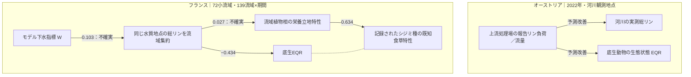
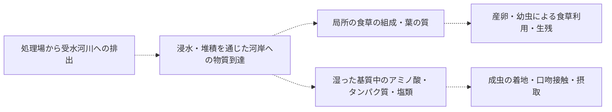

# 下水排出の生態影響は河岸を越えるか――河川水質と陸上の植物・植食者の対応

## 序論

下水処理場から河川に放出された窒素やリンは、どのような条件で河岸の生物にも影響するのだろうか。河道内では、排出口と観測地点の上下流関係をたどり、処理場の報告負荷を河川流量、水質、底生動物群集の状態と照合できる。河岸の植物が同じ栄養塩に接する機会は、水と堆積物が河道の外に運ばれる頻度や範囲にも左右される。ドイツのムルデ川では、洪水後の氾濫原草地で、植生上や地表に堆積した土砂とそこに含まれる窒素・リンが実測されている。このような水陸間の輸送が放流を受ける河川でも生じるなら、水中の栄養濃度の違いが、河岸に生育する植物の種構成にも表れる可能性がある。[ムルデ川氾濫原での堆積物と栄養塩の調査](https://pmc.ncbi.nlm.nih.gov/articles/PMC8638890/)

植物の種構成が変わると、その場所で植食者が利用できる餌の種類も変わる。たとえば、富栄養な立地を好む植物の割合が高い場所では、そうした植物を食草とする植食者が群集に占める割合も高いと予想される。ただし、この対応は、放流水が河岸に届いた場合にも、農地や市街地を含む流域景観が植物と植食者の双方の分布に関わる場合にも生じうる。両者を吟味するには、排出口の上下流で実測水質と植物相が対応するかという局所的な問いと、同じ流域にどの植物と植食者が分布するかという広域的な問いを、それぞれの観測単位で検討する必要がある。

この二つ目の問いを調べるうえで、蝶類には、幼虫が利用する食草が種ごとに記載されているという利点がある。各流域に記録された植物が好む立地と、そこに記録された蝶の既知の食草が好む立地を、共通の植物指標で比較できる。そこで本研究では、アゲハチョウ科、シロチョウ科、タテハチョウ科、セセリチョウ科、シジミチョウ科の5科を対象とした。群集全体の食草特性に流域間の違いがあれば、科ごとの記録割合が変わることで生じたのか、それぞれの科の内部で異なる食草を利用する種の構成が変わったのかを区別できる。この比較で捉えるのは、出現した種から推定される食草利用の可能性であり、個々の幼虫の摂食には別の観察が必要となる。[欧州の蝶類の幼虫食草目録](https://doi.org/10.1002/ece3.10834)

科内の種構成を詳しく検討する例として、シジミチョウ科に着目した。同科には、幼虫が利用する食草の栄養立地特性が同属種の間でも異なる例があり、流域の植物相との対応を種の違いに即して検討できる。一方、水辺に成虫が出現する理由は幼虫の食草だけでは決まらない。熱帯の野外実験ではシジミチョウ科の雄がアルブミンを含む餌に誘引されており、湿った基質を利用するための飛来も考えられる。したがって本研究では、科内の食草特性と植物相の対応を検証し、成虫が河岸で利用する資源については、出現記録から識別できない別の経路として扱う。[Beck et al. 1999](https://pubmed.ncbi.nlm.nih.gov/28308154/)

以上を踏まえ、欧州の河川を対象に、上流処理場の報告負荷が河川の総リン濃度と底生動物群集の状態にどう対応するかを調べた。次に、同じ排出口の上下流で、水中の総リンと周辺の植物の栄養立地特性に整合した差が現れるかを検討した。最後に、水質、植物、蝶の記録が重なる小流域では、河川の総リンと流域の植物相のそれぞれが、シジミチョウ科の記録割合と科内の食草特性をどこまで予測するかを比較した。こうした比較を通じて、河川内で捉えた下水関連の勾配と、陸上の植物・植食者の対応を結ぶ経路のうち、どの区間に観測上の支持があるかを評価した。

## 図1　想定する生態経路と実際に検証できた区間

**A　同じ標本内の統計的な経路。** 各枠は別の標本。矢印はモデル上の予測方向を表す。フランスの数値は標準化係数で、オーストリアの予測改善率とは単位が異なる。

Aの底生EQRとシジミの間の無向点線は、同じ流域での条件付き関連の点検（係数 −0.112、区間はゼロを含む）を示す。底生群集は水域側の生態応答である。

**B　河岸で成立しうる相互作用。** 点線は今回の標本で直接測っていない過程。Aの流域平均・底生指標を、Bの局所的な利用行動や資源量に置換しない。

## 本文の骨子

**方法。** 排出源と水質・底生状態を河川地点で結んだ標本、排出口の上下流の対応標本、水域と陸域を共通の小流域に集約した標本を用いる。フランスの水質・EQRは2018年と2022年の反復地点、植物・蝶はそれぞれ2017–19年と2020–22年の出現記録。調整付き回帰式を同一139行に適用し、24上位流域を単位に3,000回再標本化して全式を再推定した。以下の95%区間は探索的。別地域の係数を掛け合わせない。[フランスの元標本](https://github.com/zuizui0223/gesui/pull/114)

**結果1　排出源から河川内まで。** 欧州では2018年と2022年の双方で、年間報告N/P負荷がEQRの地域外予測を約1%改善した。オーストリア68地点では、上流報告P／流量を加えると実測TPとEQRの予測誤差がそれぞれ16.30%、19.27%減少した。位置を精査した67地点でも、実測TP・周辺土地被覆・排出報告の有無を考慮したEQR予測が10.44%改善した。P／流量は希釈を仮定した排出指標で、到達量や特定化学種の効果は識別していない。[欧州2018](https://github.com/zuizui0223/gesui/pull/17)・[欧州2022](https://github.com/zuizui0223/gesui/pull/14)・[オーストリア](https://github.com/zuizui0223/gesui/pull/118)

**結果2　排出口で水域と陸域をつなぐ。** ドイツ6排出口では、2011–22年の同月の上下流TP差と、河川沿いの地点を中心とする半径1 kmの植物相を照合できた。両側の植物形質の記録条件を満たした4排出口すべてで下流側の植物栄養立地スコアは低かった。うち1排出口では、TPが下流で2.083倍でも植物スコア差は−0.978。残り3排出口ではTPも下流側で低い。水質地点は排出口から7–25 km離れ、直接水のかかった植物個体は追えていない。欧州976地点で周辺250–500 mの土地被覆がEQR予測を3.42%改善した結果も、景観と河川状態の空間対応として示す。[排出口別の全6対](evidence/DE6_interface_contrasts.csv)・[ドイツの採集設計](https://github.com/zuizui0223/gesui/pull/7)・[欧州の土地被覆](https://github.com/zuizui0223/gesui/pull/123)

**結果3　蝶群集全体から科内の構成へ。** 欧州454流域×期間で、モデル下水指標に沿った蝶5科の平均食草スコアの傾きの約96%が、各科の内部で記録される種の違いに由来した。シジミ科で十分な記録のある426行では、同指標による科内食草スコアの予測改善が14.62%。科ごとの観測条件は異なり、科別の形質ラベル検証は多重補正後に不確実。早期に成虫の生態からシジミに着目しており、5科から初めて発見された唯一の応答科とは扱わない。独墺の写真記録割合の初期陽性は前年調整で弱まった。[当初の仮説](https://github.com/zuizui0223/gesui/pull/20)・[5科の分解](https://github.com/zuizui0223/gesui/pull/94)・[科内の結果](https://github.com/zuizui0223/gesui/pull/95)・[科別検証](https://github.com/zuizui0223/gesui/pull/101)・[写真割合の感度分析](https://github.com/zuizui0223/gesui/pull/26)

**結果4　同一流域で経路を接続する。** フランス共通標本ではTPと底生EQRの係数は−0.434［−0.654, −0.279］、植物相とシジミの食草特性の係数は+0.634［+0.116, +0.880］。その間のTPと植物相の係数は+0.027［−0.170, +0.229］。W→TP→植物相→食草特性の係数積は+0.002［−0.030, +0.038］。共有流域上では二つの区間に対応があるが、連鎖全体の間接効果は特定できなかった。植物相と食草の指数には共通する立地形質資料が使われる。植物相の追加で種均等の食草スコア予測は18.19%改善した一方、シジミの5科中の記録割合では改善が見られなかった。[全式の係数と区間](evidence/fr_interface_paths.csv)・[地域留保・時間差の結果](evidence/fr_lyca_water_land.csv)

## どの接続が未観測か

| 接続 | 標本・空間単位 | 現在の判定 |
|---|---|---|
| 報告負荷 → 水質・底生状態 | オーストリアの同一河川地点・同一年 | 予測関係あり。実際の排出由来割合や河岸への到達は未測定 |
| 水質 → 陸上植物 | ドイツ排出口ペア、フランス小流域 | 上下流差・調整付き回帰を検証。河岸への物質移動、葉の化学組成、洪水直後の応答は未観測 |
| 植物相 → 蝶 | 欧州・フランスの小流域×複数年 | 出現種の食草特性との空間対応あり。現地の産卵・幼虫の摂食・生残は未観測 |
| 同じ排出口の植物 → シジミ群集 | 別の欧州16排出口、河道上で上下流各1.5 km・各半径1 km | 2020–22年に両側で植物20件以上かつシジミ1件以上が3排出口。両側の科内食草構成を評価できた排出口は両期間とも0。オーストリア67水質地点と蝶パネルの地理的重複も3小流域4地点。[地点設計](https://github.com/zuizui0223/gesui/pull/115)・[67地点の重複台帳](evidence/AT67_basin_overlap.csv) |
| 河岸基質 → 成虫摂食 | 仏・独・墺、2017–22年の指定されたiNaturalist吸水基質欄 | 当該欄の記録は0。基質のタンパク質・塩類、口吻接触、下水由来成分の摂取のいずれも今回の排出口で未測定。記録の欠如から行動の不在は推定できない。[国・年別照合](evidence/adult_substrate_coverage.csv) |

**成虫の出現をどう読むか。** 食草カタログは幼虫が利用しうる植物を示すが、水辺で観察された成虫には、その場へ飛来して湿った基質を利用する個体も含まれうる。熱帯のシジミチョウ科の雄がアルブミン餌に誘引された実験は、食草を介する経路と成虫自身の資源利用を区別する理由になる。この第二の経路は図1Bの仮説であり、本研究では餌の成分と摂取行動を測定していない。[Beck et al. 1999](https://pubmed.ncbi.nlm.nih.gov/28308154/)

**考察の結び。** 本研究で最も不確かな接続は、河川水中の変化が、河岸で植物や成虫が実際に使う資源の変化へ変換される区間である。水域内と陸域内の観測上の対応を、それぞれの空間単位に戻して提示することで、どの部分に物質輸送・摂食の直接観測が必要かを特定できる。米国で実測された水生昆虫羽化量は水陸移動の別の実例だが、欧州の同じ排出口・蝶の利用記録と接続していない。[羽化量の別標本](https://github.com/zuizui0223/gesui/pull/61)

本稿は2026年11月17日時点の既存解析の統合案。添付CSVは既存の集計出力で、図中の数値を照合するために収録した。
