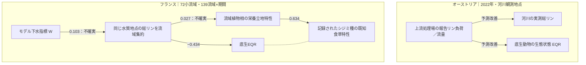
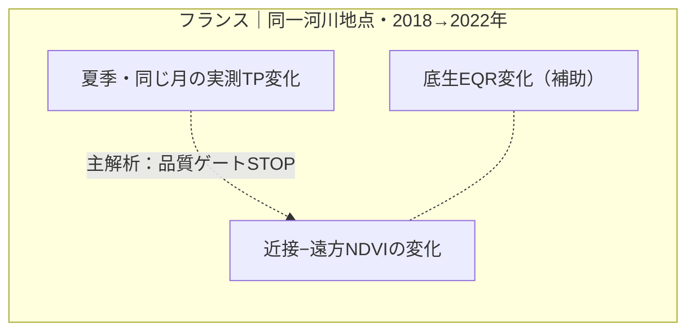
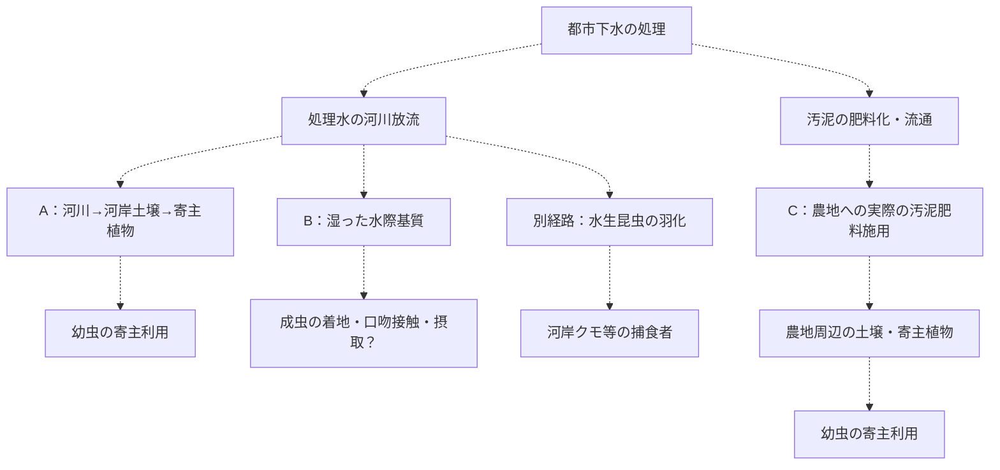

# 下水排出に関連する河川生物の応答は陸上の植物・蝶群集にも表れるか

## 要旨（改稿案・主要結果3文／限界1文）

都市排水を含む人為起源の栄養負荷は河川生物群集に影響しうるが、河川水質の地理的な違いが周辺の陸上植物や植食者の群集にも反映されるかは明らかでない。本研究では、欧州の処理場排出報告、実測河川水質、底生無脊椎動物の生態状態、植物群集の栄養立地特性、および蝶類の既知寄主の栄養立地特性を用いて、水域内・陸域内・水陸間の関連を比較した。

**第一に、** 上流処理場の報告栄養塩負荷は底生動物の生態状態の地域外予測に追加情報を与え、フランスの共通139小流域×期間では河川総リンと底生動物の生態状態に負の関連が認められた（標準化係数 −0.434、95%区間［−0.654, −0.279］）。

**第二に、** 陸域では植物相の栄養立地特性と蝶類の既知寄主特性に正の関連が認められ、欧州451流域×期間の植物–蝶比較では標準化係数 +0.196［+0.145, +0.247］、フランスの共通標本における植物–シジミチョウ科の比較では +0.634［+0.116, +0.880］だった。

**第三に、** 同じフランスの共通標本でも、河川総リンと植物相の栄養立地特性との関連は不確実であり（+0.027［−0.170, +0.229］）、モデル下水指標から植物相を経てシジミチョウ科の寄主特性に至る統計的な間接効果もゼロを含んだ（+0.002［−0.030, +0.038］）。

ただし、観測尺度と時期には違いがあり、水域と陸域の負荷源を直接比較する追加解析は共通標本25地域・6か国で事前の地理的基準に届かず停止したため、下水由来の栄養塩移行や実際の資源利用は検証できなかった。

以上から、水域内の水質–生物状態と陸域内の植物–植食者の潜在的資源特性にはそれぞれ明瞭な対応がある一方、両者を一つの下水由来栄養塩経路として説明できるかは未確定であることが示された。

## 序論

下水処理場から河川に放出された窒素・リン・有機物は、受水河川の生物群集の状態と関連しうる。一方、処理水由来の物質が河岸の生物へ渡ること自体は未知の現象ではない。下水影響河川では水生昆虫・河岸クモを対象とした安定同位体・微生物叢の研究やマイクロプラスチック移行の研究がすでに報告されている（[2025年の原著](https://doi.org/10.1016/j.envpol.2025.125948)、[2026年の原著](https://doi.org/10.1016/j.envpol.2026.129116)）。ただし、これらの局所的な水陸移行の実証は、欧州全域の栄養勾配が植物–蝶の群集変化に至るという主張とは異なる。

植物群集の栄養立地特性が場所によって異なれば、その植物を幼虫の既知寄主とする蝶の群集構成にも対応が見られるかもしれない。しかし、その対応は、植物と蝶が共通の土地利用・気候・地理に分布するためにも起こりうる。既知寄主の形質は現地幼虫の摂食や成虫の資源利用を直接意味せず、水域側の底生動物EQRも種の耐性形質の直接測定ではない。

本研究は「川の水質が周囲の陸の生き物の状態を映すか」を問うため、（1）下水関連負荷・実測河川水質と底生動物EQR、（2）陸上植物の栄養立地特性と蝶の潜在寄主の特性、（3）共通流域内における水質–植物相の対応を比較する。源の地理と生物の地域を一致させられない追加検定は、結果を開く前の品質基準で停止し、異なる標本の係数を連鎖の因果効果として掛け合わせない。

## 結果

**結果1｜河川内では栄養負荷が底生動物の生態状態の予測に情報を加える。** 欧州の2018年・2022年の独立した監視年において、上流の年間処理場報告N/P負荷を加えると、底生動物EQRの地域外予測MSEがPでそれぞれ約0.98%・1.10%、Nで約1.19%・1.40%改善した。オーストリアでは同一年の上流報告P/流量指標が実測総リンと底生EQRの予測誤差をそれぞれ16.30%・19.27%減らした。フランス共通139小流域×期間では、実測総リンと底生EQRの標準化係数は−0.434［−0.654, −0.279］だった。これらは生態状態・予測情報の関連であり、処理水による耐性種への置換や因果効果そのものを計測していない。[欧州2018](https://github.com/zuizui0223/gesui/pull/17)・[欧州2022](https://github.com/zuizui0223/gesui/pull/14)・[オーストリア](https://github.com/zuizui0223/gesui/pull/118)

**結果2｜陸域では植物相と蝶の潜在寄主の栄養立地形質が対応する。** 欧州451 H7流域×期間で、植物群集の種均等NUTRIと蝶の種均等既知寄主HNSは、排水関連地理や土地利用・記録努力を調整した後も正に関連した（β=+0.1956［+0.1446,+0.2465］、真正H6留保の追加予測MSE改善+36.56%［+15.34,+49.51］）。異なるH7を同一H6内で比較しても植物NUTRIと蝶HNSの関連は正（β=+0.1181［+0.0587,+0.1774］）だったが、属間の植物構成が主な信号で、属内での固有な形質選別は不確実だった。フランスの共通139流域×期間に限った植物–シジミチョウ科の既知食草特性の係数は+0.634［+0.116,+0.880］。これらは現地の食草消費量・蝶の増減を表さない。[植物–蝶の元解析](https://github.com/zuizui0223/gesui/pull/102)・[同一H6の厳格な属間分解](https://github.com/zuizui0223/gesui/pull/105)・[フランス同一標本](https://github.com/zuizui0223/gesui/pull/114)

**結果3｜共通流域でも水域から陸域へ一つの関連経路として接続するとは判定できない。** フランスの139小流域×期間で、河川総リンと植物NUTRIの係数は+0.027［−0.170,+0.229］、モデル下水指標→総リン→植物相→シジミチョウ科の統計的係数積は+0.002［−0.030,+0.038］で、いずれもゼロを含んだ。水域EQRとシジミチョウ科の残差対応も不確実であり、同一H7の2017–19→2020–22の植物NUTRIと蝶HNSの差分は明瞭な同期を示さなかった。いずれも「生物学的に水陸が切れている」という検定ではない。[経路係数表](evidence/fr_interface_paths.csv)・[時空間の限界と地域留保](evidence/fr_lyca_water_land.csv)・[時間差と地理補正](https://github.com/zuizui0223/gesui/pull/102)

## 図1｜観測された水域内・陸域内の関連、境界の検定条件、未観測の資源経路

**A　同じ標本内の統計的な経路。** 各枠は別の標本。矢印はモデル上の予測方向を表す。フランスの数値は標準化係数で、オーストリアの予測改善率とは単位が異なる。

Aの底生EQRとシジミの間の無向点線は、同じ流域での条件付き関連の点検（係数 −0.112、区間はゼロを含む）を示す。底生群集は水域側の生態応答である。

**B　同一河川地点の水質–植生比較：主解析は品質基準未達。** 2018→2022年の実測総リン（TP）と河道近接域・遠方域の衛星植生指数（NDVI）を一致させる設計を検討したが、事前固定した単一衛星シーンで有効なのは116/178地点であり、最低120地点の品質基準に届かずSTOPした。事後的な雲補完による122地点の探索結果は[補足解析S1](SUPPLEMENTARY_ANALYSES_AND_SOURCE_STOPS_20261119.md)へ移した。

本比較は陸上の種組成・生物による資源摂取を測定しない。事後122地点では2018年上流WWTP報告リン陽性が0地点のため、処理水由来の陸域効果の不在を評価した検定ではない。

**C　下水由来資源が陸上生物に届くかもしれない3経路（未実測）。** 経路Aは処理水→河川→河岸寄主→幼虫、Bは水際の湿った基質→成虫、Cは**汚泥の肥料化→施用農地→寄主植物→幼虫**である。汚泥肥料は処理場から別地域へ運ばれる場合もあるため、Cは河川と同じ流域内であると仮定しない。破線は今回のデータで直接測っていない仮説である。

「処理水・汚泥のδ¹⁵Nが高い」という性質だけではAとCを識別できず、家畜ふん尿・土壌窒素とも値が重なりうる。実際の汚泥施用農地、対象の寄主植物、幼虫の採食、成虫の摂取は今回のマクロデータでは確認していない。詳細な一次資料と次の野外研究案は[汚泥を経由する経路Cの文献監査](SLUDGE_TO_HOST_BUTTERFLY_ROUTE_C_LITERATURE_20261119.md)に保存した。

## 考察

**同じ栄養関連勾配への応答は、同じ選別機構の実証ではない。** 河川では実測総リンの高い場所ほど底生動物EQRが低いという関連があり、陸域では栄養豊富な立地を好む植物相と、そのような立地を好む既知寄主を利用する蝶種の記録構成が対応していた。ただしEQRは「耐性種が増加した」ことを直接測る尺度ではなく、植物NUTRIと蝶HNSは原形質資料の共有・属構成・検出努力の影響を受ける。したがって「水と陸で同一の資源選択則が実証された」ではなく「水域と陸域でそれぞれ栄養環境に関連する生物群集指標が対応する」と結論する。

**水陸間に関連が検出されないことは、連結の不在を意味しない。** フランスの共通139流域の統計的経路で総リンと植物相の関連は不確実だった。観測単位をさらにそろえる試みでは、同一河川2018–22年の衛星比較の元主検定は品質基準未達で停止した。122地点に増えた事後補完標本には2018年上流WWTP報告リン陽性地点が0しかなく、下水特異的な不在効果は検定できない。[補足S1](SUPPLEMENTARY_ANALYSES_AND_SOURCE_STOPS_20261119.md)

**異なる栄養負荷源が水域と陸域を駆動する可能性は、今回の結果では仮説にとどまる。** JRC公表の269 NUTS2地域・28か国では、水へのモデル点源N（処理場と産業を含む）と陸への大気N沈着・鉱質肥料・有機肥料・生物固定の単純相関はそれぞれ+0.051、+0.069、+0.011、+0.166だった。これは各源の地理勾配が強くは重ならないことを示唆するが、条件付き独立や生物への異なる因果作用の証拠ではない。さらに、2018河川監視地点と2017–19植物・蝶記録の共通地理を公式GISCO2016 1:100万境界で厳格に照合したところ、25 NUTS2地域・6か国しか残らず、あらかじめ固定した40地域・8か国の下限に達しなかったため、点源×陸域投入の2×2生物解析は実行せずSTOPした。[source-only結果](https://github.com/zuizui0223/gesui/blob/analysis/gesui-jrc-point-diffuse-source-gate-20261118/docs/manuscript_riparian_interactions/JRC_NUTS2_SOILN_POINTN_SOURCE_GATE_RESULT_20261118.md)・[正式SOURCE-STOP](https://github.com/zuizui0223/gesui/blob/analysis/gesui-jrc-point-diffuse-source-gate-20261118/docs/manuscript_riparian_interactions/BIOTIC_2X2_GISCO01M_FINAL_SOURCE_STOP_20261118.md)

**河川を通らない下水由来窒素の経路。** 下水処理場由来の汚泥が肥料や土壌改良材として農地等に施用されれば、処理水を河川へ放流する経路とは別に、下水由来の窒素が陸の植物へ入る可能性がある。EUの2022年汚泥報告では農業・その他土壌用途が約39.9%、日本の2024年度汚泥肥料利用率は約15.5%と報告され、地域差もある。ただしこれらは処理場側の利用区分であり実際の施用圃場の位置や窒素到達量ではない。現在の陸域N投入モデル（DAYCENT有機施肥など）は**下水汚泥施用を識別したデータではない**ため、本研究の正の植物–蝶の関係を経路Cの実証として扱わない。植物による汚泥由来¹⁵Nの吸収、汚泥施用によるガ類等の群集変化は既報であり、新たな問いは特定寄主→幼虫への下水由来N移行と処理水経路との識別である。[一次資料と研究案](SLUDGE_TO_HOST_BUTTERFLY_ROUTE_C_LITERATURE_20261119.md)

**監視と次の実測研究への含意。** 河川のEQR変化だけから河岸の蝶の群集・個体数の変化を予測できるとは現データから言えず、逆に両者が生態学的に独立とも断定できない。処理水が実際に葉や蝶へ届くかを検証するには、放流口上下流と対照区で水・堆積物・河岸土壌・寄主植物の化学組成や同位体、幼虫の寄主利用・成虫の基質摂食を同じ季節に測る必要がある。水と陸で別の管理策が必ず必要、あるいは下水対策が蝶には効かない、という介入的結論はまだ出せない。

## 本文から除いた解析・資料

- **フランス同一河川122地点の事後的な雲補完、ドイツ6放流口の上下流差、観測できない各資源経路の詳細：** [補足解析とSOURCE-STOP台帳](SUPPLEMENTARY_ANALYSES_AND_SOURCE_STOPS_20261119.md)。原論文の主要な独立結果には含めない。
- **カナダ8処理場、Bow River、米国産業排水・PFASなどの原著者公表データの再集計：** 独立した本研究の結果から除いた。局所の水陸移行の存在を示す原著は序論で引用する。再解析の出所監査はリポジトリ内の別ファイルと原コミット履歴に保存する。

研究対象の期間・地理・観測単位が異なる係数を掛け合わせて下水→水→陸→蝶の媒介効果を作らない。生物2×2はSOURCE-STOP、事後探索的な調整解析を確証的実験と呼ばない。**本稿はDraftであり、既存mainの事実確認済み結果とは別にレビューする。**
