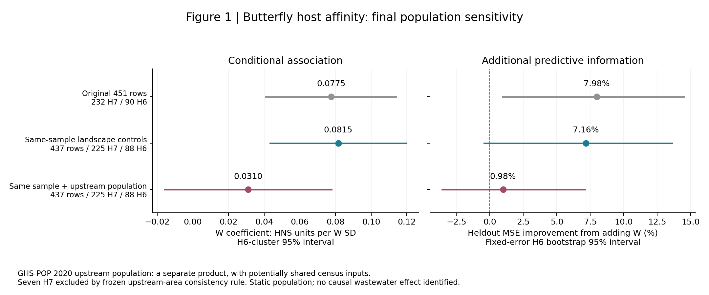
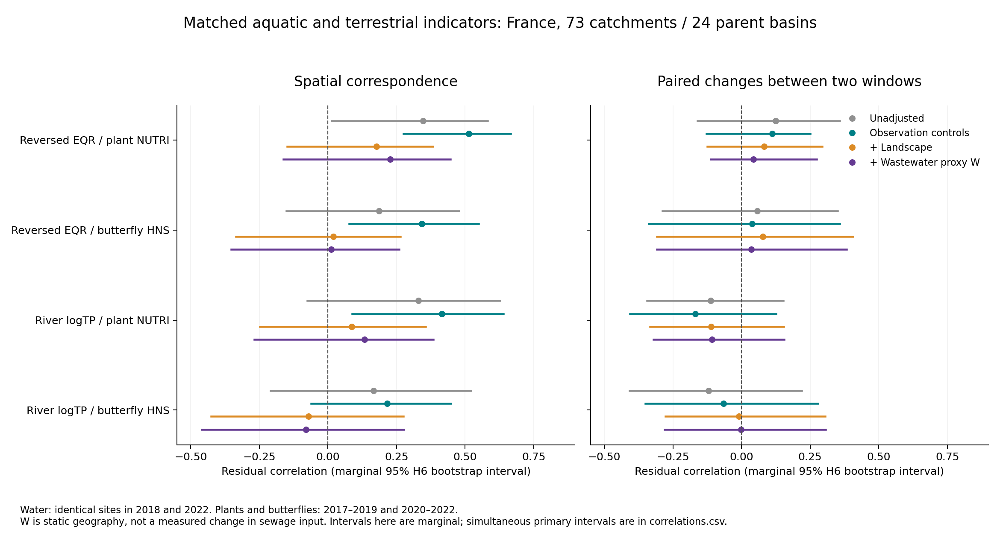
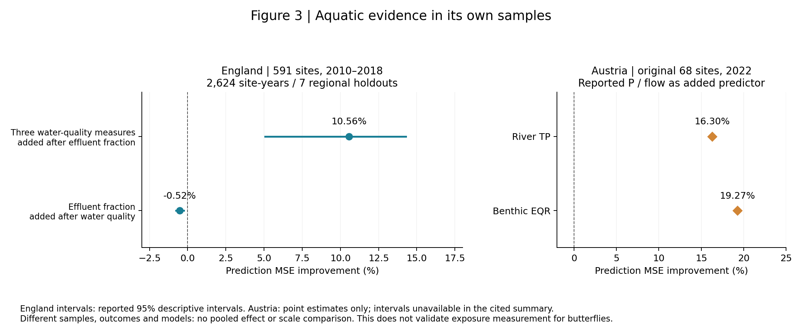

# 指導教員確認用：要旨と3図

2026年11月21日完成。最終感度解析までを含む観測研究のレビュー用セット。新規解析はここで止め、本文表現・構成の検討に移る。投稿先の字数・図規格への最終調整前。人口感度解析の[仕様・出所・数値](POPULATION_FINAL_SENSITIVITY_20261120.md)を併読する。

## 仮題

**下水関連の地理勾配と蝶の寄主資源特性：人口集積と水陸の共変動**

## 要旨案

下水に関連する環境勾配は、河川の生物群集だけでなく、周辺の植物資源と陸域の植食者の構成にも対応する可能性がある。しかし、下水関連の信号を人口集積や土地利用から区別し、水域と陸域の応答を結び付けられるかは明らかでない。本研究では、欧州の232小流域・451流域×期間について、下水関連のモデル指標、植物の栄養立地嗜好、蝶5科の既知幼虫寄主の栄養立地嗜好を統合し、景観・観察条件を調整した関連と親流域を留保した予測を評価した。さらに、別製品の人口格子を上流流域へ集約した固定感度解析と、フランス73小流域における水域・陸域指標の並列比較を行った。

欧州では、耕地・都市・面積・流量等を調整した後も、下水関連指標が高いほど蝶群集が富栄養な立地の植物を寄主とする種に偏り、下水指標の追加は予測誤差を7.98%減少させた。ただし、人口照合の品質条件を満たした437行の同一標本では、上流人口密度を加えると係数は+0.0815から+0.0310へ弱まり、人口調整後の95%区間は−0.0158〜+0.0778、追加予測改善は0.98%［−3.56, +7.12］と不確実になった。フランスでは、水生昆虫の低い生態状態と植物の高い栄養立地嗜好が空間的に対応したが、景観調整で弱まり、2期間の同調変化は支持されなかった。植物相と蝶の寄主特性の空間的対応は残った。英国・オーストリアの水域結果は、化学環境や処理場関連指標の予測情報を示したが、蝶への曝露の妥当性や水陸間の物質移行を検証するものではなかった。

以上より、下水関連地理と蝶の資源利用特性の対応は認められる一方、人口集積から独立した下水の作用は現在の広域指標では識別できなかった。水域と陸域の空間的対応を、河川から陸への物質移動やその不在とは区別する必要がある。汚泥施用や成虫の栄養利用は、この研究では未測定の経路である。

## 図1：蝶の結果と最後の人口感度解析

[PDF](figures/population_final/FIGURE1_butterfly_population.pdf)。左はWの条件付き係数、右はWを追加する親流域留保予測のMSE改善率。灰色は元451行、青と赤は地理品質条件を満たした**同じ437行**で、人口調整前後を比較する。係数の区間はH6クラスタ95%、予測の区間は固定H6誤差再標本化の記述95%区間。異なる推定量を同じ効果とみなさない。人口調整前の縮小標本でも予測区間はゼロを含み、標本差と人口追加の影響を分ける。改善率は蝶の増加率ではない。

## 図2：水と陸の空間的対応と時間差

[PDF](figures/population_final/FIGURE2_water_land_correspondence.pdf)。フランス73 H7・24 H6で、左は2期間平均の空間相関、右は後期−前期の差分相関。水域は同一地点の2018/2022年、陸域は2017–2019/2020–2022年。EQRは方向をそろえるため反転したが、栄養専用の指標には変わらない。観察条件、景観、Wの調整段階を全て示す。表示は周辺95%区間で、主要比較の同時区間は[結果表](../../results/20261120_water_land_covariation/correlations.csv)に収録。観察条件調整後の水生昆虫―植物の空間対応は同時区間でも正だが、蝶との比較は同時区間がゼロを含む。空間相関を時間的同調や因果連鎖とは呼ばない。

## 図3：水域内の別標本における予測情報

[PDF](figures/population_final/FIGURE3_aquatic_context.pdf)。英国591地点では、モデル処理水割合に実測3水質を加える予測改善と、水質に処理水割合を加える増分を区別した。3水質はオルトリン酸・硝酸・アンモニア性Nである。区間は元解析の記述95%区間。オーストリアの元68地点では、報告P／流量指標によるTPとEQRの改善点推定を示す。引用した集約表に区間がないため、誤差棒を作っていない。国間で標本・基準モデル・応答が違い、効果量の統合やスケール比較は行わない。これは水域内の参照証拠であり、蝶の曝露を保証する厳密な陽性対照ではない。

## このセットで主張しないこと

- 「下水は河川を通らず蝶に届く」「同調がない」「汚泥が原因」は示していない。
- 人口調整による弱まりは人口の因果作用や下水の無影響を確定しない。
- シジミの探索的結果・成虫栄養利用の文献は本文の補足・考察へ置き、蝶全体の主結果と混同しない。
- Virginia汚泥データは本論文の生態解析から除外し、別研究候補として保管する。

[図生成コード](../../analysis/20261120_population_sensitivity/figures.py)・[出所と出力ハッシュ](figures/population_final/receipt.json)。3図は数値・出所を確認し、PNG表示も確認済み。指導教員への送信は行っていない。
