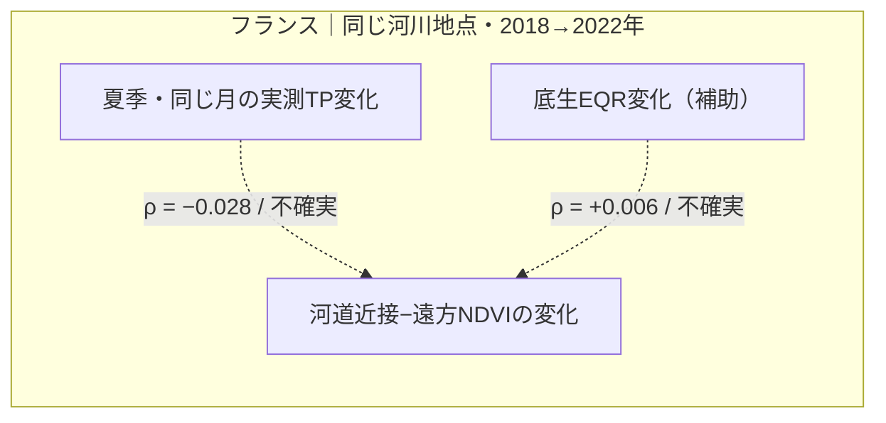

# 補足解析・出所監査（論文主結果には含めない）

この補足資料は、原草稿から移動した水陸境界・上下流探索と出所制約を記録する。2026年11月19日の編集。解析仕様・合否・数値は書き換えず、公開済み原本の再計算を新しい独立研究として提示しない。

## S1｜フランス同一河川2018–2022：事前品質ゲートと事後122地点

**同一河川・同一月の二時点比較。** 別のフランスの元263同一水質・底生観測地点から、真正河道への位置適合と両年の夏季実測TP観測機会だけで178地点（58 H7・23 H6）を固定した。河道に沿う±500 mの区間で、水際20～100、100～250、250～500、500～1,000 mの4帯それぞれに有効10 m自然被覆画素100以上、両年で同一暦月2か月以上を要求した。単一シーンでは116地点のため主解析はSTOP。事後的な雲補完（事前選択した同月最大2シーン、共通投影格子・反射率オフセット補正）による122地点だけを探索的に評価した。場所×時点を一致させたTP–NDVI検定と、広域小流域の植物–蝶構成検定は**異なる標本・異なる被説明変数**として別々に扱い、係数を一つの因果パスとして掛け合わせない。[方法・source品質](https://github.com/zuizui0223/gesui/blob/analysis/gesui-20261117-onepaper-pathway-identification-decision/docs/RESULTS_20261117_FR178_TRUE_RIVER_S2_116_SITE_STOP_PIXEL_SOURCE_DIAGNOSTICS.md)

**結果3　同じ河川・同じ夏季観測月で水陸の変化を比較する。** フランスの実測TP・I2M2 EQRが2018年・2022年に同じ地点で観測された263地点のうち、真正河道と夏季観測月の条件から178地点を固定した。事前に定めた単一シーンの品質基準は116/178で未達。別の事後的な雲補完法を使うと、122地点（44 H7、22 H6）で河道から20～100 m対500～1,000 mのNDVIを2018→2022年の同一夏季月で比較できた。実測TPの変化と相対NDVIの変化のSpearman相関は**ρ = −0.028**、22親流域を再標本化した記述的95%区間は**［−0.436, +0.316］**。土地利用・流量・流域面積・2018年NDVIを含むモデルにTP変化を追加しても、親流域留保のMSEは**−3.73%**しか「改善」せず、実際には悪化した（記述的95%区間**［−9.19%, +2.25%］**）。同じ標本の底生EQR変化とNDVI変化も**ρ = +0.006**で連動を検出できなかった。ただしEQRの測定日は必ずしも同じ夏季月ではない。衛星合格122地点は不合格56地点よりTPが高い傾向があり、完全ケース解析の選択バイアスを考慮する必要がある。さらに**元2018年の上流WWTP報告リン負荷が正の地点は、この122地点中0地点**である（元263地点1件→位置・観測月適格178地点1件→画素適格122地点0件）。唯一の報告陽性地点は、2022年6月・8月の河道から20～100 mの有効画素がそれぞれ79・78（基準100以上）となり、2か月の必須条件を満たさなかった。ゆえに**今回のTP–NDVI非検出は下水特異的な水陸波及効果の検定ではない**。未報告排水の可能性を認めつつ、原本で確認できる源報告陽性の比較が成り立たないことを明示する。[元263→178→122の源データ照合](evidence/fr122_2018_upstream_WWTP_report_support_audit.csv)・[方法と欠測原因](MACRO_PATHWAY_IDENTIFICATION_LITERATURE_AND_POSITIVITY_AUDIT_20261117.md)。これは広域の共通環境勾配が直接的な水陸資源移行として現れたことを示す結果ではない。[源原本と予測検証](evidence/fr122_same_station_TP_NDVI_2018_2022.csv)・[実行済み解析](https://github.com/zuizui0223/gesui/actions/runs/44020568960)

### 原草稿の図1Bと品質注記（保存版）

**B　水域・陸域を同じ河川地点と同じ夏季観測月で結んだ検証。** 2018→2022年の実測TPと、河道線から20～100 mのNDVIから500～1,000 mのNDVIを引いた差の変化を比較した。点線は「検証したが明確な連動が見られない」関係を示し、生物が移動した経路を意味しない。

元の単一衛星シーンの品質基準は**116/178地点で事前基準120地点に届かずSTOP**。さらに、2018年のEEA上流WWTP報告リン負荷が正の地点は、元263地点に1地点、選定済み178地点に1地点、実画素が揃った122地点には**0地点**だった。2018年報告負荷の未検出は下水実在の不在ではなく、2022年の移行量の不在でもない。この標本のTPは、下水に特異的な実際の到達量ではない。事前に候補として選ばれていた同月2シーンの雲補完を*事後的な技術的感度解析*として行った場合に限り、**122地点・44小流域・22親流域**で上の比較を実行した。主たる元検定の不合格判定を取り消さず、未検出を「移行が存在しない」と読まない。[実測河川・衛星解析の原本検証](evidence/fr122_same_station_TP_NDVI_2018_2022.csv)・[詳細と原本Actions](https://github.com/zuizui0223/gesui/blob/analysis/gesui-20261117-onepaper-pathway-identification-decision/docs/RESULTS_20261117_FR178_TRUE_RIVER_122_POSTHOC_MOSAIC_MEASURED_JJA_TP_NDVI_NULL.md)

**位置づけ：** 事前単一シーン116/178は120地点の基準に届かずSTOP。後から2シーンで得た122地点の相関は事後的・記述的。**2018年上流WWTP報告リン陽性0/122**なので下水特異的な水陸波及効果の検定ではない。原稿本文の「負の結果」を補強する独立実証に数えない。

## S2｜ドイツ6放流口の上下流・植物指標

**結果2　排出口近傍と河岸景観の対応を点検する。** ドイツ6排出口では、2011–22年の同月の上下流TP差と、河川沿いの地点を中心とする半径1 kmの植物相を照合できた。両側の植物形質の記録条件を満たした4排出口すべてで下流側の植物栄養立地スコアは低かった。うち1排出口では、TPが下流で2.083倍でも植物スコア差は−0.978。残り3排出口ではTPも下流側で低い。水質地点は排出口から7–25 km離れ、直接水のかかった植物個体は追えていない。欧州976地点で周辺250–500 mの土地被覆がEQR予測を3.42%改善した結果も、景観と河川状態の空間対応として示す。[排出口別の全6対](evidence/DE6_interface_contrasts.csv)・[ドイツの採集設計](https://github.com/zuizui0223/gesui/pull/7)・[欧州の土地被覆](https://github.com/zuizui0223/gesui/pull/123)

**位置づけ：** 実測水質地点が放流口から7〜25 km離れており、TPそのものが下流で低い地点を含む。処理水曝露の局所因果効果や河岸への移行を示す比較ではない。主結果から除く。

## S3｜公表データの再集計と独立標本を区別する

カナダ8処理場のマイクロプラスチック、Bow Riverの安定同位体、米国USGSの産業排水PFAS・生態系機能の公開原本再解析は、既発表の研究を再集計・監査したものであり、本稿の独立な栄養塩・植物–蝶解析とは物質・時空間単位が異なる。個別の計算メモは元の原稿履歴・次の監査ファイルに保持する：

- [Grand River公開原本・生物段階監査](GRAND8_SOURCE_VERIFIED_LARVAE_ADULT_SPIDER_UPDOWN_MICROPLASTICS_20261117.md)
- [Grand River同年段階の完全性・STOP](GRAND8_20261118_CHRONOLOGY_AND_CROSS_STAGE_COGRADIENT.md)
- [Bow River研究・出所監査](MEASURED_TRANSFER_BOW5_GRAND8_SOURCE_GATE_20261117.md)
- [Farmington米国PFAS・試料ID照合](FARMINGTON_USGS_5STREAM_REAL_PFAS_SOURCE_YEAR_SPECIMEN_MATCH_20261118.md)
- [食品加工排水のPFAS原本監査](USGS_INDUSTRIAL_PFOS_FTS_LARVAE_ADULT_SPIDER_SOURCE_VERIFIED_20261118.md)
- [同研究の栄養・機能測定](USGS_INDUSTRIAL_2022_REAL_NUTRIENT_ECOSYSTEM_FUNCTION_UPDOWN_20261118.md)

**広域統合計画に伴う補足（2026-11-20）：** 公表データの再解析は、比較条件と依存関係を保てばマクロ解析・メタ解析に利用できる。ここで除外しているのは「新たな独立野外標本」としての二重計上であり、二次解析一般ではない。物質・経路・応答の違う原研究を栄養–植物–植食者の係数へ置換しない。

局所植物比較については[固定原表からの再構成と統合採否](LOCAL_INTERFACE_INTEGRATION_20261120.md)を追加した。6放流口の対比は再現したが、植物–シジミの全比較側支持は0であり、新たな全鎖推定は行っていない。

## S4｜観測していない区間とSOURCE-onlyの最終STOP

## どの接続が未観測か

| 接続 | 標本・空間単位 | 現在の判定 |
|---|---|---|
| 報告負荷 → 水質・底生状態 | オーストリアの同一河川地点・同一年 | 予測関係あり。実際の排出由来割合や河岸への到達は未測定 |
| 水質 → 陸上植物 | ドイツ排出口ペア、フランス小流域 | 上下流差・調整付き回帰を検証。河岸への物質移動、葉の化学組成、洪水直後の応答は未観測 |
| 実測水質の時間変化 ↔ 河岸植生指数の時間変化 | フランス同一河川122地点・2018→2022年・同じ夏季暦月（事後的雲補完の探索標本） | ρ = −0.028、TP追加の親流域外予測改善−3.73%。連動は検出できず。元の単一シーン116地点は事前品質条件未達。**2018年のWWTP上流報告P陽性0/122で源特異的効果は識別不可** |
| 植物相 → 蝶 | 欧州・フランスの小流域×複数年 | 出現種の食草特性との空間対応あり。現地の産卵・幼虫の摂食・生残は未観測 |
| 同じ排出口の植物 → シジミ群集 | 別の欧州16排出口、河道上で上下流各1.5 km・各半径1 km | 2020–22年に両側で植物20件以上かつシジミ1件以上が3排出口。両側の科内食草構成を評価できた排出口は両期間とも0。オーストリア67水質地点と蝶パネルの地理的重複も3小流域4地点。[地点設計](https://github.com/zuizui0223/gesui/pull/115)・[67地点の重複台帳](evidence/AT67_basin_overlap.csv) |
| 河岸基質 → 成虫摂食 | 仏・独・墺、2017–22年の指定されたiNaturalist吸水基質欄 | 当該欄の記録は0。基質のタンパク質・塩類、口吻接触、下水由来成分の摂取のいずれも今回の排出口で未測定。記録の欠如から行動の不在は推定できない。[国・年別照合](evidence/adult_substrate_coverage.csv) |

**成虫の出現をどう読むか。** 食草カタログは幼虫が利用しうる植物を示すが、水辺で観察された成虫には、その場へ飛来して湿った基質を利用する個体も含まれうる。熱帯のシジミチョウ科の雄がアルブミン餌に誘引された実験は、食草を介する経路と成虫自身の資源利用を区別する理由になる。この第二の経路は図1Cの仮説であり、本研究では餌の成分と摂取行動を測定していない。[Beck et al. 1999](https://pubmed.ncbi.nlm.nih.gov/28308154/)

**考察の結び。** 本研究で最も不確かな接続は、河川水中の変化が、河岸で植物や成虫が実際に使う資源の変化へ変換される区間である。水域内の実測TP–底生状態、陸域内の植物相–蝶の既知食草特性には観測上の対応がある。しかし同じ河川・同じ夏季観測月に時空間を揃え、河道からの距離で陸域指標を測っても、TP変化と河畔NDVIの近遠差変化の連動は検出できなかった。これを水陸資源輸送が存在しない証拠とみなさない。そもそも厳格な122地点の同年源報告陽性サポートはないため「下水からの伝播なし」とも結論できない。2025–26年の直接的な水陸移行研究を踏まえれば、広域的に一般化できる条件こそ未解決である。観測しているNDVIと未観測の物質輸送・葉質・羽化昆虫・成虫基質摂食を区別することで、どの段階に直接観測が必要かを特定できる。[先行研究・マクロ指標・曝露識別性の監査](MACRO_PATHWAY_IDENTIFICATION_LITERATURE_AND_POSITIVITY_AUDIT_20261117.md)。米国で実測された水生昆虫羽化量は水陸移動の別の実例だが、欧州の同じ排出口・蝶の利用記録と接続していない。[羽化量の別標本](https://github.com/zuizui0223/gesui/pull/61)

本稿は2026年11月17日時点の既存解析の統合案。添付CSVは既存の集計出力、または原本のGitHub Actions実行結果から対応する同一地点・同一月・サンプル品質の指標を転記した検証台帳であり、新たな独立フィールド観測ではない。各パネルの推定量・観測単位・年の違いを保持したまま提示する。`main`には未統合のDraft。

### JRC点源N×陸へのN投入・生物共通標本の追加監査

JRCの水へのモデル点源Nと、陸域への大気沈着・鉱質肥料・有機肥料・生物固定モデルは269 NUTS2地域・28か国で全値がそろう。元単純相関は+0.051、+0.069、+0.011、+0.166。出所の低相関を生物の独立な応答へ直結させない。

GISCO2016公式01M境界と2018河川底生・2017–19植物EIV品質合格流域を厳格に照合した結果、共通25 NUTS2・6か国・43真正H6・16独立地理成分となり、凍結済み主2×2ゲート（≥40地域・≥8か国等）を満たさずSOURCE-STOP。2×2の生態応答モデルは実行していない。[完全な監査と判定](https://github.com/zuizui0223/gesui/blob/analysis/gesui-jrc-point-diffuse-source-gate-20261118/docs/manuscript_riparian_interactions/BIOTIC_2X2_GISCO01M_FINAL_SOURCE_STOP_20261118.md)。

## S5｜公開された局所的水陸移行研究（序論での引用のみ）

- [2025年自治体排水と水陸無脊椎動物食物網](https://doi.org/10.1016/j.envpol.2025.125948)
- [2026年8処理場の水生昆虫・河岸クモのマイクロプラスチック](https://doi.org/10.1016/j.envpol.2026.129116)
- [産業排水PFAS研究](https://doi.org/10.1021/acs.est.5c04867)

これらの原著は水陸物質移行の既知事例を示すが、本研究の下水由来N/Pの広域植食者応答の再現検定にはならない。
