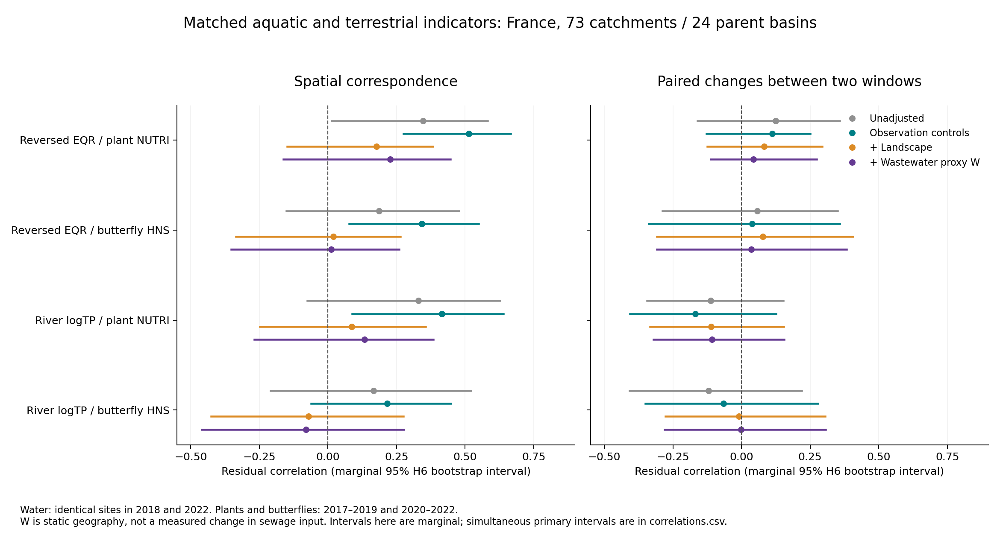

# 水域と陸域は同調するか：共通流域での検証

2026年11月20日。新規の探索的解析。**水生昆虫の生態状態と陸域の植物構成には空間的対応があるが、景観条件を調整すると弱まる。下水関連指標Wが独自に共変動を説明する証拠、および2期間の時間的同調は得られなかった。** 非有意は同調の不在や汚泥経路の成立の証明ではない。

続く[共通要因・頑健性の検証](WATER_LAND_SHARED_DRIVERS_20261120.md)では、単一親流域への依存を調べ、景観条件が留保親流域の予測も改善することを確認した。下記の元解析・時間差の結論は変更していない。

## 問いと比較単位

水域→陸域という因果の向きを置かず、水域と陸域を並列の応答として比較した。主解析はフランス73 H7小流域・24 H6親流域、両期間計146行。水質・底生動物は同じ物理的観測地点の2018年と2022年、植物・蝶は2017–2019年と2020–2022年の出現記録である。

- 空間比較：各小流域の2期間平均、73行。
- 時間比較：各小流域の後期−前期、73行。年々の同期ではなく、2つの期間の差分の対応。
- 蝶全体：5科の得点済み種を等重みした既知幼虫寄主HNS。個体数・摂食・成虫のタンパク質利用ではない。
- シジミ：既存の条件（得点記録10以上・2種以上・記録カバー率70%以上）を両期間で満たす67流域・24 H6。従来の139行の標本とは異なり、両期間を対にした134行。科特異性の独立検定ではない。

水域指標はlogTPとEQR。図表ではEQRの符号を反転し、高い値が低い生態状態を示すようにした。これは栄養専用の指標への変換ではない。植物NUTRIは立地嗜好、HNSは既知寄主の立地嗜好であり、葉・蝶体の窒素濃度を測っていない。

## 方法

各応答を同じ説明変数で重み付き最小二乗回帰し、残差の相関と共分散を推定した。H6ごとの合計重みを等しくし、H6を単位に3,000回の再標本化を行い、毎回すべてのモデルを再推定した。

比較は無調整、観察条件、観察条件＋W、観察条件＋景観、観察条件＋景観＋Wの5仕様。観察条件は植物・蝶の記録機会、植物得点カバー率、蝶得点記録カバー率、水域の観測地点数。時間差では記録機会・カバー率の差分を使い、水域はTP採水機会の差分を使った。景観は耕地・都市・面積・流量・自然流出の5変数であり、**個別のどれが原因かは分解していない。気候はこの固定入力に含まれず調整できていない。**

Wは2期間で同じ値だった。時間差モデルに入れたWは、静的なWと生物変化の対応であり、下水の増減の効果ではない。時間差モデルの景観項も2期間平均で、景観変化の因果効果ではない。

主要比較は反転EQR―植物、反転EQR―蝶全体の2組×空間・時間の4比較。各モデル仕様について、この4比較に対する最大絶対ブートストラップ誤差による近似同時95%区間も計算した。下記の通常の区間・図は周辺95%区間で、全モデル・探索的比較を通じた多重性調整ではない。TP・シジミ・領域内比較は補足とし、有意な仕様だけを選ばない。

## 主結果

| 対応 | 観察条件調整後 r［周辺95%区間］ | 景観を追加 | さらにWを追加 |
|---|---:|---:|---:|
| 空間：反転EQR―植物 | +0.514［+0.276, +0.665］ | +0.177［−0.148, +0.383］ | +0.227［−0.162, +0.447］ |
| 空間：反転EQR―蝶全体 | +0.342［+0.078, +0.550］ | +0.020［−0.335, +0.265］ | +0.012［−0.353, +0.260］ |
| 時間差：反転EQR―植物 | +0.112［−0.127, +0.251］ | +0.083［−0.125, +0.294］ | +0.043［−0.112, +0.274］ |
| 時間差：反転EQR―蝶全体 | +0.038［−0.337, +0.358］ | +0.078［−0.308, +0.406］ | +0.036［−0.308, +0.384］ |

観察条件調整後の空間的な反転EQR―植物は、主要4比較の同時区間でも正だった［+0.147, +0.880］。同じ仕様の反転EQR―蝶全体は同時区間がゼロを含んだ［−0.025, +0.708］。無調整では前者r=+0.347［+0.013, +0.582］、後者r=+0.186［−0.152, +0.478］であり、観察条件の調整により相関は強まった。観察量は完全な検出率ではなく、この変化だけで測定バイアスを除去できたとは言えない。

TP―植物の空間相関は観察条件調整後+0.415［+0.088, +0.640］、景観・W調整後+0.134［−0.268, +0.384］だった。TP―蝶全体は両仕様とも不確実だった。水陸の時間差の対応は、無調整から全調整まで一貫して区間がゼロを含んだ。

## 共変動は下水で説明できたか

共通の結果尺度を固定し、説明変数の追加前後の残差共分散を、同じブートストラップ標本内で差し引いた。正の値は追加後に共分散が減ることを示す。分母が小さい場合に不安定になる「説明率％」は出していない。

| 空間的な対応 | 観察条件に景観5変数を加えた共分散減少［95%区間］ | 景観調整後にWを加えた共分散減少［95%区間］ |
|---|---:|---:|
| 反転EQR―植物 | +0.269［+0.080, +0.418］ | −0.012［−0.037, +0.039］ |
| 反転EQR―蝶全体 | +0.186［+0.054, +0.281］ | +0.002［−0.016, +0.032］ |

景観モデルにより水陸の共分散が減少したが、**これは標本内の統計的分解であり、景観の原因特定や未知流域での予測成功ではない。** W固有の寄与は支持されず、反転EQR―植物では点推定が逆方向だった。時間差でもWによる減少は植物との組で+0.029［−0.045, +0.069］、蝶との組で+0.030［−0.040, +0.061］と不確実だった。静的Wが水陸の変化を共通に駆動したとは言えない。

## 陸域内の対応とシジミ

植物―蝶全体の空間相関は景観・W調整後も+0.660［+0.490, +0.785］、植物―シジミは67流域で+0.630［+0.184, +0.783］だった。一方、同仕様の反転EQR―シジミは+0.089［−0.391, +0.394］だった。

植物―シジミの時間差は無調整で負（−0.271［−0.488, −0.004］）だったが、全調整後は−0.156［−0.465, +0.196］と不確実。この反対向きの結果も保持し、「すべて同調した」とはまとめない。植物―蝶全体の時間差も全調整後+0.123［−0.311, +0.379］と不確実だった。植物と寄主の指標は関連する形質資料に基づくため、空間相関の強さを独立した栄養取り込みの実証としない。

## 論文に使える記述

> 水域と陸域を並列の応答として比較すると、同じフランス小流域における底生動物の低い生態状態は、富栄養な立地を好む植物からなる植物相と空間的に対応した。この対応は観察条件の調整後にも認められたが、土地利用・流域条件を加えると弱まった。植物相と蝶の潜在寄主特性の対応はこれらの調整後も残った一方、下水関連地理の独自の共変動説明、および2期間の水陸の同調変化は不確実だった。したがって、領域をまたぐ空間的対応は認められるものの、下水による共通駆動や水域から陸域への物質移行は特定できなかった。

既存の条件付きパス係数と今回の残差相関は推定対象が異なる。旧139行の結果を置き換えず、「水陸の対応自体が全くない」とする解釈を修正する補足とする。汚泥・成虫栄養利用はこの解析では未測定で、支持された経路に格上げしない。

## 再現と検証

[解析仕様](../../analysis/20261120_water_land_covariation/PROTOCOL.md)・[解析コード](../../analysis/20261120_water_land_covariation/analyse.py)・[入力ハッシュ・実行記録](../../results/20261120_water_land_covariation/receipt.json)・[全相関](../../results/20261120_water_land_covariation/correlations.csv)・[下水寄与](../../results/20261120_water_land_covariation/W_covariance_contribution.csv)・[景観寄与](../../results/20261120_water_land_covariation/landscape_covariance_contribution.csv)・[Wの各応答係数](../../results/20261120_water_land_covariation/W_response_slopes.csv)。

リポジトリ直下で、既存アーカイブを含む親`work`を使い、`python -B analysis/20261120_water_land_covariation/analyse.py`、続いて`python -B analysis/20261120_water_land_covariation/plot.py`。別配置は`--work`で指定する。入力アーカイブの取得元は既存の[FR139再現記録](FR139_REPLAY_AND_INTEGRATION_20261120.md)と元の[再構築コード](../../analysis/20261115_hns_family_taxon/analyse.py)を参照。リポジトリ単独では外部アーカイブが揃わない。

4組すべてで3,000/3,000ブートストラップがフルランク。元データのハッシュ・キー、同一地点の水質・EQR差分恒等式、静的W、既知の共通要因を入れた合成データ、全再標本内の共分散分解恒等式を検証した。入力・スクリプトのハッシュを保存した。別実装（statsmodels）で全150相関の点推定を照合し、最大絶対差1.6×10⁻¹⁵だった（[検証記録](../../results/20261120_water_land_covariation/validation.json)）。図の文字・区間表示も確認した。

[PDF図版](../../results/20261120_water_land_covariation/water_land_covariation.pdf)
