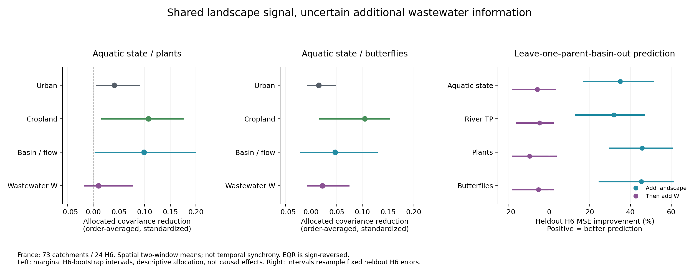

# 水陸の対応を説明する共通要因と頑健性

2026年11月20日。[水陸共変動解析](WATER_LAND_COVARIATION_20261120.md)の探索的追試。同じフランス73小流域・24親流域の2期間平均を用い、新しい独立標本を追加したものではない。

**水域と陸域の接点として、耕地を含む景観勾配への共通応答が具体的に見えてきた。水生昆虫―植物の対応は単一親流域に依存せず、景観条件は未使用親流域の水域・陸域両指標の予測を改善した。一方、下水指標Wの独自の説明・予測寄与は依然不確実である。** 空間的な共通応答を時間的同調や物質移行と呼ばない。

## 解析の追加範囲

元の観察条件を固定し、都市、耕地、流域・流量（面積・流量・自然流出）、Wの4群の全16組合せを比較した。残差共分散の減少を、説明変数の追加順序を全順序で平均するShapley配分で記述した。これは相関する説明変数に共有部分を配分する規則であり、原因の特定ではない。単独追加と他の全変数調整後の固有寄与も保存した。負の寄与は抑制関係を示し、切り捨てない。

H6等重み、3,000回のH6ブートストラップで全モデルを再推定。区間は探索的な周辺95%区間で、候補間の多重性を調整していない。最大の点推定を「最重要因子」と確定しない。変数群をどうまとめるかにも配分は依存する。

## 1. 単一地域だけの対応ではなかった

親流域を1つずつ除く24回の再推定で、観察条件調整後の反転EQR―植物の相関は**0.448–0.573**だった。反転EQR―蝶全体は0.272–0.427だった。元の相関0.514／0.342は特定の1親流域だけで生じたものではない。ただし、この範囲は信頼区間ではなく、独立した地域での再現証拠でもない。

景観条件を加えた同じ除外比較では、反転EQR―植物は0.128–0.277、反転EQR―蝶は−0.053–0.120だった。調整による弱まりも、単一親流域の除外によって覆らなかった。

## 2. 耕地と流域条件が共有する空間的な信号

| 変数群 | 反転EQR―植物の共分散減少への配分［95%区間］ | 反転EQR―蝶全体への配分［95%区間］ |
|---|---:|---:|
| 都市 | +0.041［+0.006, +0.090］ | +0.015［−0.007, +0.047］ |
| 耕地 | +0.108［+0.017, +0.174］ | +0.105［+0.017, +0.152］ |
| 流域・流量 | +0.099［+0.003, +0.199］ | +0.047［−0.020, +0.128］ |
| 下水関連指標W | +0.010［−0.017, +0.076］ | +0.022［−0.007, +0.074］ |

値は元の結果変数の標準化尺度における共分散で、百分率ではない。全配分の和は、観察条件のみのモデルから全候補を追加したときの共分散減少に等しいことを各再標本で確認した。

全変数を同時に入れたモデルでも、耕地の係数は反転EQR +0.340［+0.035, +0.577］、植物NUTRI +0.468［+0.241, +0.646］、蝶HNS +0.435［+0.243, +0.583］だった。したがって、**耕地の多い景観で、水域の生態状態低下と陸域の富栄養立地型構成が並行して現れる**という方向は整合している。ただし、施肥、農薬、河道改変、地理・気候などを分離しておらず、「農業由来窒素が原因」とは言えない。係数は元標本の説明変数SDあたり、H6等重みの結果SD単位である。

## 3. 未使用の親流域でも景観条件に予測情報がある

24親流域を1つずつ完全に除外して予測した。標準化は訓練標本だけで推定、Ridgeの強さは既存比較に合わせalpha=10に固定し、調整しなかった。訓練時はH6等重み、評価は親流域ごとのMSEの等重み平均を用いた。

| 応答 | 観察条件モデルに景観を加えたMSE改善率 | さらにWを加えたMSE改善率 |
|---|---:|---:|
| 水生昆虫の生態状態（反転EQR） | +34.94%［+17.04, +51.40］ | −5.66%［−17.91, +3.13］ |
| 河川logTP | +31.81%［+12.90, +46.71］ | −4.66%［−16.12, +1.93］ |
| 植物NUTRI | +45.72%［+29.89, +60.40］ | −9.59%［−17.97, +3.43］ |
| 蝶全体HNS | +45.32%［+24.66, +61.10］ | −5.17%［−17.88, +1.90］ |

区間は固定した24親流域の予測誤差を5,000回対応再標本化した記述区間であり、訓練モデル全体の不確実性を再推定した区間ではない。これは同じフランス標本内の親流域外予測で、国外・別年代への転送ではない。各指標の予測改善は「共分散そのものの予測」を直接検証したものでもない。

全4指標で景観の追加が予測を改善し、単なる標本内の相関減少だけではなかった。一方、W追加の改善率は点推定で負、すべての区間がゼロを含んだ。「下水は悪化させない」や「下水の影響はない」という意味ではない。

## 4. 下水の役割はどこまで分かるか

観察条件を取り除いたWの分散の**63.5%［42.5, 88.8］**は、景観変数によって標本内で説明された。下水指標は都市・農地・流域条件から完全に独立した地理ではない。この部分R²は生物への効果量でも、下水効果の63.5%が景観に隠れたという量でもない。

Wだけを観察条件に追加したときも、水陸の共分散減少は不確実だった。反転EQR―植物は+0.040［−0.010, +0.145］、反転EQR―蝶は+0.048［−0.008, +0.132］。したがって、Wの追加寄与が弱いことを単に「他の変数で調整しすぎたため」と救済する根拠もない。

現時点の位置付けは、**下水関連の景観で見えた水陸の構成差を、より一般的な土地利用・流域勾配の共有と、下水固有の部分に分けたところ、前者は支持され、後者は未確定だった**というものである。下水を独立した駆動要因として強めるには、実際の放流量・汚泥施用先など、今回の静的Wとは別の曝露情報が必要になる。成虫の栄養利用や汚泥経路を、この結果から支持済みに格上げしない。

## 本文用の追記

> 水陸の空間的対応は、単一の親流域を除いても維持された。都市、耕地、流域・流量条件および下水関連指標への共分散配分では、耕地に水生昆虫―植物および水生昆虫―蝶の双方の共有信号が認められた。景観条件は親流域を留保した水域・陸域指標の予測も改善したが、下水関連指標の追加による改善は不確実だった。これらは共通の景観勾配への応答を支持する一方、下水固有の影響や栄養物質の水陸間移動を識別するものではない。

## 出力と検証

[解析仕様](../../analysis/20261120_water_land_covariation/FOLLOWUP_PROTOCOL.md)・[コード](../../analysis/20261120_water_land_covariation/shared_drivers.py)・[実行記録](../../results/20261120_water_land_covariation/shared_drivers/receipt.json)・[全寄与配分](../../results/20261120_water_land_covariation/shared_drivers/covariance_allocation.csv)・[全条件付き係数](../../results/20261120_water_land_covariation/shared_drivers/full_model_slopes.csv)・[親流域除外相関](../../results/20261120_water_land_covariation/shared_drivers/leave_one_H6_correlations.csv)・[留保予測](../../results/20261120_water_land_covariation/shared_drivers/heldout_prediction.csv)。

リポジトリ直下から`python -B analysis/20261120_water_land_covariation/shared_drivers.py`、`python -B analysis/20261120_water_land_covariation/plot_shared_drivers.py`。元解析と同じ外部アーカイブが必要。3,000回すべてフルランク、全再標本で配分和の恒等式を検証した。別の24順序計算との一致、元解析の保存済み相関との一致、訓練・留保親流域の非重複と予測値の有限性を確認した。図も表示確認した。以前の時間差の不確実性は変更しない。

[PDF図版](../../results/20261120_water_land_covariation/shared_drivers/shared_drivers.pdf)
